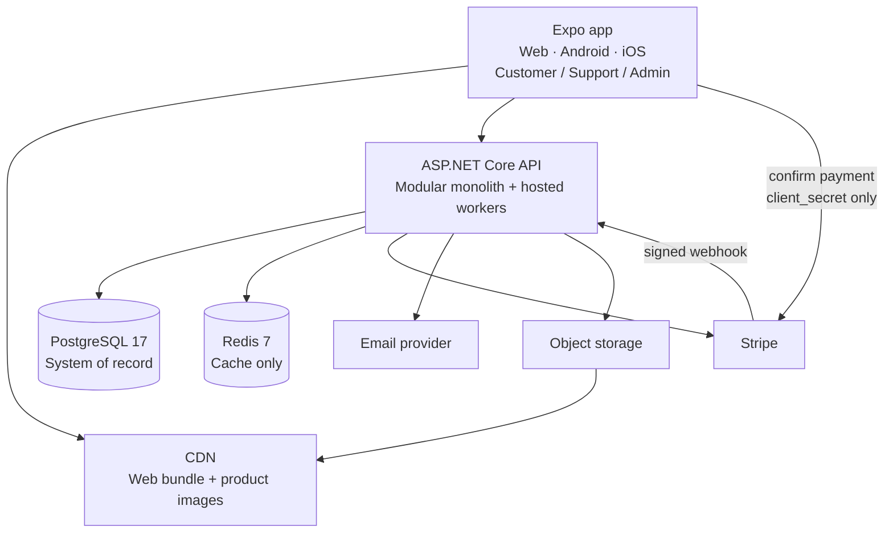

## 4. System diagram

- Clients never touch Postgres, Stripe secret keys, or object storage credentials.
- The signed webhook is the only path by which the outside world changes payment state.
- Workers (expiry, outbox consumers, projectors) run in the API process in v1.

