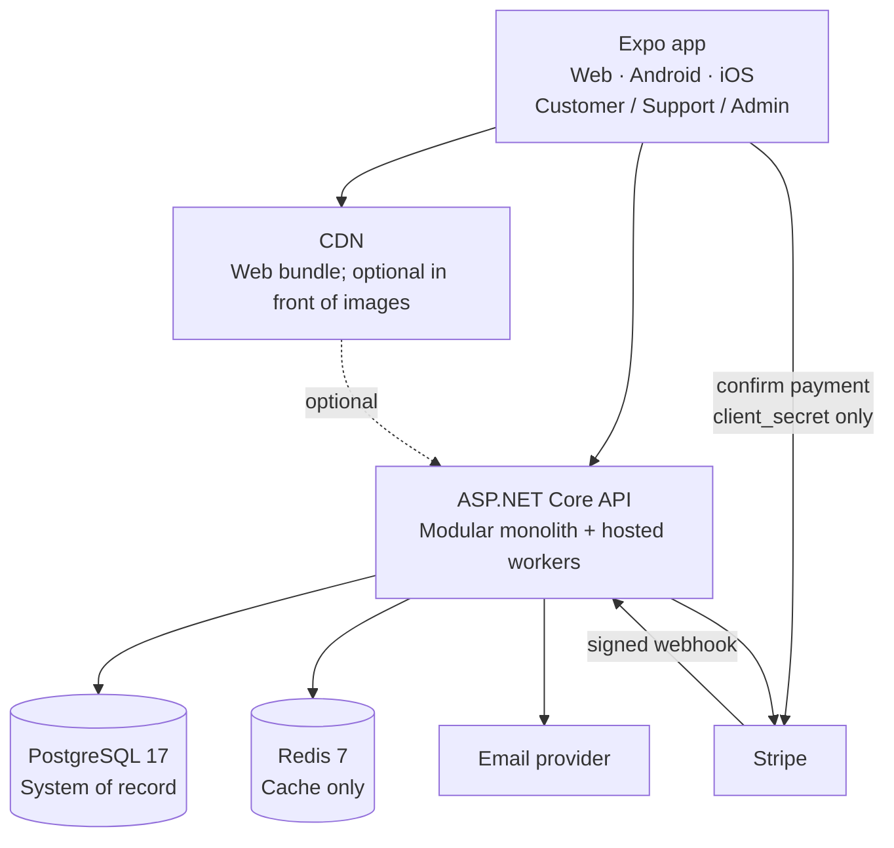

## 4. System diagram

- Clients never touch Postgres or Stripe secret keys. Product images are served by the API from Postgres (`image_blobs`, §2).
- The signed webhook is the only path by which the outside world changes payment state.
- Workers (expiry, outbox consumers, projectors) run in the API process in v1.

