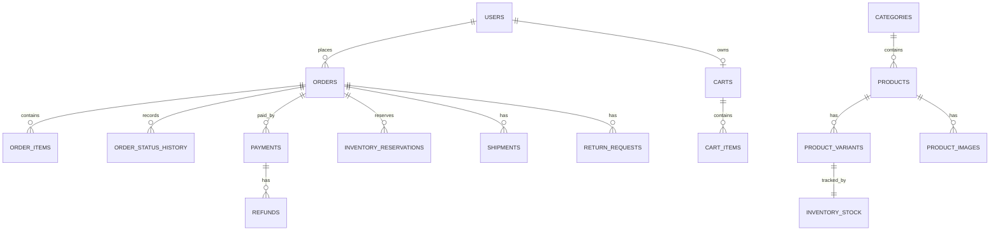
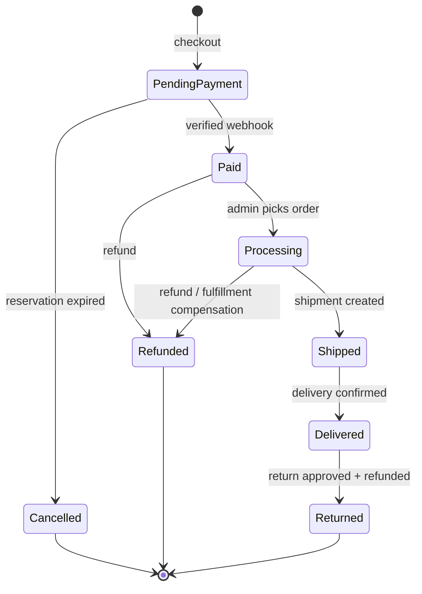

## 7. Data model

Money is `numeric(19,4)` with a currency on every amount — never `float`/`double`. Timestamps are `timestamptz` UTC. Migrations are the source of truth; this is the v1 shape.

### 7.1 Tables

| Table | Columns and constraints |
|---|---|
| users | id, email (citext, unique), display_name, password_hash (ASP.NET Core Identity v3 format), security_stamp, role (`Customer` / `Support` / `Admin`, CHECK), access_failed_count, lockout_end, created_at, updated_at. Module-owned table, not the Identity EF stores (Slice 1b D1) |
| refresh_token_families | id, user_id, created_at, absolute_expires_at, revoked_at, revoked_reason (`Logout` / `Reuse` / `PasswordReset`) |
| refresh_tokens | id, family_id, token_hash (bytea SHA-256, unique — never the token), created_at, expires_at, consumed_at, replaced_by_id |
| password_reset_tokens | id, user_id, token_hash (unique), requested_at (the request event's time; Slice 6), created_at, expires_at, used_at, invalidated_at. Single use, newest request only |
| addresses | **Not created in v1.** Checkout takes an inline address that is snapshotted on the order (§9 checkout contract, §13.2). Saved addresses wait until Nathaniel scopes them |
| categories | id, slug (unique), name, parent_id (nullable, one level in v1) |
| products | id, slug (unique), name, description, category_id, is_active (default false), created_at, updated_at |
| product_variants | id, product_id, sku (unique), name, size, colour, price, currency, compare_at_price, weight_grams, is_active |
| product_images | id, product_id, storage_key, alt_text, sort_order |
| image_blobs | storage_key (PK, varchar 512), content_type (JPEG/PNG/WebP only), size_bytes, sha256 (bytea, 32), content (bytea, ≤ 5 MB), created_at. Image bytes (§2, P2.56); `product_images.storage_key` points here, no FK. Never updated; orphans kept (GC is backlog) |
| inventory_stock | product_variant_id (PK), quantity_on_hand, quantity_reserved, `xmin` concurrency token. **CHECK (on_hand − reserved ≥ 0 AND reserved ≥ 0)** |
| inventory_reservations | id, order_id, product_variant_id, quantity, status, expires_at, created_at. Unique partial (order_id, variant_id) WHERE status = 'Active' |
| carts | id, user_id (unique — one cart per user), updated_at |
| cart_items | id, cart_id, product_variant_id, quantity (CHECK > 0), display_unit_price, currency, added_at, updated_at. Unique (cart_id, variant_id). `display_unit_price` is the price last shown to the customer, refreshed on every add or set; it is used only to report `PriceChanged`, never for a total |
| orders | id, order_number (unique, e.g. `ORD-2026-000123`), user_id, status, subtotal, discount_total (always 0 in v1 — no discounts feature), shipping_total, tax_total, grand_total, currency, shipping_method_code, shipping_method_name (snapshot), shipping_address_snapshot (jsonb), billing_address_snapshot (jsonb, nullable — not collected in v1; Stripe collects card billing details), idempotency_key (unique), version (the current intent is the latest `payments` attempt — no copy on the order, Slice 4 §13.2), created_at, updated_at |
| order_items | id, order_id, product_variant_id, sku_snapshot, name_snapshot, unit_price_snapshot, quantity, line_total |
| order_status_history | id, order_id, from_status, to_status, changed_by, reason, created_at |
| payments | id, order_id, attempt (int, unique (order_id, attempt)), provider, provider_payment_id (unique, nullable until the intent exists), amount, currency, status, created_at, updated_at. One row per payment attempt |
| refunds | id, payment_id, amount, currency, status (`Pending` / `Succeeded` / `Failed`, CHECK), reason, actor_id (null for an automatic refund), idempotency_key (unique), provider_refund_id (unique, nullable until Stripe answers), created_at, completed_at |
| shipments | id, order_id, carrier, tracking_number, shipped_at, delivered_at |
| return_requests | id, order_id, items (jsonb: variant, quantity), reason, status, admin_note, created_at, decided_at |
| idempotency_keys | key, scope (`checkout` / `retry-payment` / `refund` / `cart-merge` / `stripe-event`), PK (scope, key), user_id, request_hash, result_ref, response_json (jsonb, nullable — the stored reply a repeated key returns, e.g. `cart-merge`), created_at, expires_at |
| outbox_events | sequence (bigint identity, PK), event_id (uuid, unique), event_type, aggregate_type, aggregate_id, aggregate_version, payload (jsonb), occurred_at. **Append-only**, retained for replay |
| consumer_checkpoints | consumer (PK), last_sequence, updated_at |
| processed_events | consumer, event_id, PK (consumer, event_id), status (`Retrying` / `Done` / `DeadLetter`), attempts, next_attempt_at, last_error, processed_at |
| audit_log | id, actor_id, action, entity_type, entity_id, before_json, after_json, reason, created_at |

### 7.2 Day-one indexes

- `products(category_id, is_active)`; generated `tsvector` on name + description with a GIN index.
- `product_variants(product_id)`.
- `orders(user_id, created_at DESC)`, `orders(status, created_at DESC)`.
- `inventory_reservations(expires_at) WHERE status = 'Active'` — expiry job.
- `processed_events(next_attempt_at) WHERE status <> 'Done'` — retry scan.
- `order_items(order_id)`, `cart_items(cart_id)`. Unique constraints above already index their columns.

### 7.3 State machines — the only legal transitions

- **Order:** as above. A failed card does not cancel — the order stays `PendingPayment` and can be retried until the reservation expires. `Cancelled` is terminal; the customer checks out again (new key, new order). An admin **override** may force only a transition on this diagram, with a reason, and is audited. No transition rewrites totals or deletes history.
- **Payment:** `Pending → Succeeded | Failed`; `Succeeded → PartiallyRefunded | Refunded`; `PartiallyRefunded → Refunded`. `Succeeded` is set only by a verified webhook; `Failed` by a verified `payment_failed` or `canceled` webhook. A verified success after `payment_failed` on the same intent (the customer retried in the payment sheet) moves `Failed → Succeeded`; a `canceled` intent never succeeds. A retry creates a new payment record (next `attempt`) on the same order.
- **Refund:** `Pending → Succeeded | Failed`, both terminal; `Succeeded` only by a verified webhook. A **partial** refund (refunded total < captured) moves the payment to `PartiallyRefunded` and leaves the order status unchanged; a **full** refund moves the payment to `Refunded` and the order along the diagram (`Paid`/`Processing → Refunded`, or `Delivered → Returned` for an approved return). Rules: §8.5.
- **Reservation:** `Active → Committed | Released | Expired`. All three are terminal — an expired reservation never commits.
- **Return request:** `Requested → Approved | Declined`; `Approved → Refunded`. Approval moves no money; the refund does, and it is audited.

Every transition is rejected in the domain unless it is listed here. A hidden button is not a control.

### 7.4 Configured values: stock threshold, shipping, tax, carriers

v1 keeps these in configuration (`appsettings`, overridable by env vars), not in tables: there is no admin screen for them in v1 scope, and a change ships with a redeploy. Each is validated at startup (`ValidateOnStart`); an invalid value stops the API.

| Key | Shape | Rule |
|---|---|---|
| `Inventory:LowStockThreshold` | int ≥ 1, code default **5**; `appsettings.json` sets **3** from Phase 2 (§13.2) | Per variant, available = on_hand − reserved. available ≤ 0 → `Out`; 1 … threshold → `Low`; above → `InStock`. A variant with no `inventory_stock` row is `Out`. Product rollup: best active variant (`InStock` > `Low` > `Out`). From Slice 2, `Unknown` is never emitted; it stays in the v1 enum (§9: v1 is never narrowed) |
| `Store:Currency` | ISO 4217, e.g. `USD` | The one store currency. Every variant price and shipping rate must use it; checkout rejects a cart line in another currency (400) |
| `Shipping:Countries` | ISO 3166-1 alpha-2 list | Ship-to countries. Any other country → 400 at checkout |
| `Shipping:Methods` | list of `{ code, name, amount, estimatedDays }` | Flat rate per order (not per item or weight) in `Store:Currency`. Codes unique, `^[a-z0-9-]+$`; amount ≥ 0 |
| `Checkout:ReservationTtlMinutes` | int 1 – 120, default **15** | Reservation TTL set at checkout (§8.2 invariant 5); retry never extends it |
| `Tax:RatePercent` | decimal 0 – 100, committed default **0** | One flat rate on goods: `tax_total = round((subtotal − discount_total) × rate / 100, 2, half away from zero)`, rounded once at order level, never per line. Shipping is not taxed. The real rate is an owner/business value — a config placeholder, never invented by an agent |
| `Shipping:Carriers` | list of `{ code, name, trackingUrlTemplate }` | The admin ship action picks a code; unknown → 400. `trackingUrl` = template with `{trackingNumber}` URL-encoded in, built server-side |

**Order totals (Orders module, server only):** `subtotal = Σ line_total` (`unit_price × quantity`, current variant price re-read at checkout) · `discount_total = 0` · `shipping_total` = the chosen method's amount · `tax_total` per the rule above · `grand_total = subtotal − discount_total + shipping_total + tax_total`. All stored at 2 decimal places in `numeric(19,4)`. The PaymentIntent amount is `grand_total` in minor units.
