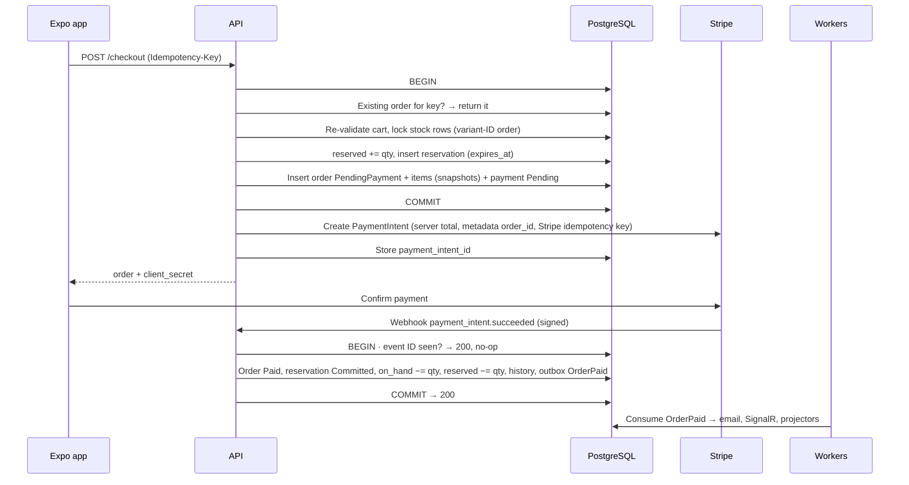
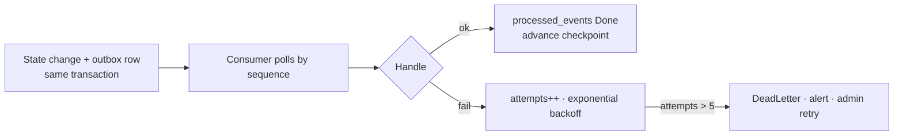

## 8. Workflows

If code contradicts this section, this section wins until it and its tests are explicitly updated.

### 8.1 Browse, search, cart

- Search, filter, sort, and pagination are server-side. Never "load all and filter on the client."
- Sorts in v1: relevance (full-text rank), price asc/desc, newest.
- The stock indicator (available = on_hand − reserved) may be cached for 10s. Checkout always re-reads Postgres under lock.
- **Server cart writes** (`POST /cart/items` adds to an existing line; `PUT /cart/items/{variantId}` sets it): the variant exists and is active, and the **resulting** line quantity is 1 … `Cart:MaxQuantityPerLine` (config, default 10) → otherwise 400. Resulting quantity > available (`IInventoryReader`, a display-grade read with no lock) → 409 with the available quantity. Any rejection changes nothing. `PUT` with quantity 0 removes the line (same as `DELETE`). Every write refreshes `display_unit_price` from Catalog and returns the whole cart, so the client applies the server result (F3). The request never carries a price (strict binding, §9).
- **Cart read** re-prices every line from Catalog and flags it: `PriceChanged` (current ≠ `display_unit_price`), `ExceedsStock` (quantity > available), `Unavailable` (variant or product inactive). Flags inform; checkout re-validates under lock (§8.2) regardless.
- **Guest cart lives on the device** (Zustand `persist` → AsyncStorage, which is `localStorage` on web; §13.2). A line is `{ variantId, productSlug, quantity, display snapshot }` — the display snapshot (name, variant, price, image key) comes from the product detail response and is shown as an estimate. Edit quantity sets the line (≥ 1); 0 or remove deletes it. Cap and stock are applied by the merge, never trusted from the device.
- **Merge on login:** `POST /cart/merge` (with `Idempotency-Key`, scope `cart-merge`) applies the rule in app context §4.4 — same variant sums, then caps at min(available, `Cart:MaxQuantityPerLine`); inactive or unknown variants are removed — and returns one result per line: `Kept`, `Capped` (with the new quantity), or `Removed`, each with a reason. A repeated key returns the first result and never re-adds (a lost response plus a client retry must not double quantities). The device cart is cleared only after a successful merge response.

### 8.2 Checkout — the core workflow

The build is judged on this. It must survive double-click, network retry, refresh after payment, duplicate webhook, late webhook, and a crash between any two steps.

**Invariants**

1. One idempotency key → at most one order.
2. One PaymentIntent → at most one order.
3. Committed quantity never exceeds on-hand quantity.
4. Client totals are ignored; the server recalculates everything.
5. Unpaid reservations expire after a TTL (config, default **15 min**).
6. No end state may be "paid without an order" or "order without a payment record."

**Rules**

1. **Idempotency first.** An existing order for the key is returned as-is. If it has no PaymentIntent yet (crash after commit), create one now.
2. **One short transaction.** Lock `inventory_stock` rows with `SELECT … FOR UPDATE` in ascending variant-ID order (prevents deadlocks). On any failure, roll back everything and return which item failed and why.
3. **Reserve, don't decrement.** `on_hand` changes only on Paid.
4. **Stripe after commit, never inside the transaction.** Every Stripe call carries a Stripe idempotency key derived from the order (e.g. `pi:{orderId}:{attempt}`). If creation fails, the order stays `PendingPayment`; `POST /orders/{id}/retry-payment` creates a new intent on the same order.
5. **The client sees only `client_secret`.** The secret key never leaves the server.
6. **Webhook is truth.** Verify the signature; dedupe the event ID in `idempotency_keys`; apply the transition, inventory commit, and outbox insert in **one** transaction. A duplicate returns 200 (a 500 makes Stripe retry forever).
7. **Expiry.** The expiry worker releases the reservation, moves the order to `Cancelled`, and emits `PaymentIntentCancelRequested` (outbox → Stripe cancel).
8. **Late success.** If `payment_intent.succeeded` arrives for a `Cancelled` order, never resurrect it: record the payment, issue an idempotent automatic refund, audit it, and alert. This closes invariant 6.
9. **Side effects only via the outbox** (§8.4).
10. **Address, shipping, totals.** The checkout body carries only the inline `shippingAddress` and a `shippingMethodCode` (§9). Inside the transaction the server re-reads prices, looks up the method and tax rate from config, computes every total per §7.4, and snapshots the address and method name on the order. An unknown method, a country outside `Shipping:Countries`, or an invalid address → 400 before any lock is taken.
11. **Retry payment** (`POST /orders/{id}/retry-payment`, owner, `Idempotency-Key` scope `retry-payment`). Allowed only while the order is `PendingPayment` **and** its reservation's `expires_at` > `IClock` now — otherwise 409 and nothing is created (the clock check does not wait for the expiry worker). One short transaction: lock the order (version), insert payment attempt n+1 (`Pending`, amount = the stored `grand_total`, never re-priced), and an outbox `PaymentIntentCancelRequested` for the previous attempt's intent. After commit, create the intent with key `pi:{orderId}:{attempt}`, store it on the payment row and as the order's current intent, return `client_secret`. The reservation is untouched: same rows, same `expires_at` — a retry never extends the TTL. A repeated key returns the same attempt and `client_secret`; a crash before the intent is created is healed by the repeat (as rule 1).
12. **One paid intent per order.** The webhook finds the order through `payments.provider_payment_id` (any attempt). `payment_failed` / `canceled` → that payment `Failed`, order unchanged. The first verified success on a `PendingPayment` order makes it `Paid`. A success on another attempt of an order that is already `Paid` (the cancel lost the race) is recorded, refunded automatically exactly once (refund key `auto:{paymentId}`), audited, and alerted — the same handling as rule 8.

### 8.3 Inventory race

Ten concurrent checkouts for the last unit: each locks the row; the first commits its reservation; the other nine see available < qty, roll back, and get a per-item out-of-stock error. The UI shows the item that sold out and offers to remove it and retry. Abandoned reservations expire with no manual fix. Proven by test 1 (§11.2).

### 8.4 Outbox

- The outbox is an append-only event log. Each consumer (email, SignalR, Stripe-cancel, dashboard, search) tracks its own checkpoint and dedupes on `(consumer, event_id)`.
- Why not send inline? Email after commit can fail silently (paid order, no confirmation, no record). Email before a rollback confirms an order that doesn't exist. The outbox removes both.
- **External effects are at-least-once.** Make them idempotent at the receiver: provider idempotency keys where supported (Stripe), otherwise a `(consumer, event_id)` check before sending. A crash between send and mark can still cause one duplicate send when the provider has no idempotency key — this is documented, tested (test 15), and must be harmless.
- Dead letters never change order state. Count > 0 is an alert, not a log line.

§8.5–8.7 (refund, fulfillment, admin catalog and inventory) are in [08.5-refund-fulfillment-admin.md](08.5-refund-fulfillment-admin.md). §8.8 (eventual consistency) is in [08.8-eventual-consistency.md](08.8-eventual-consistency.md).
