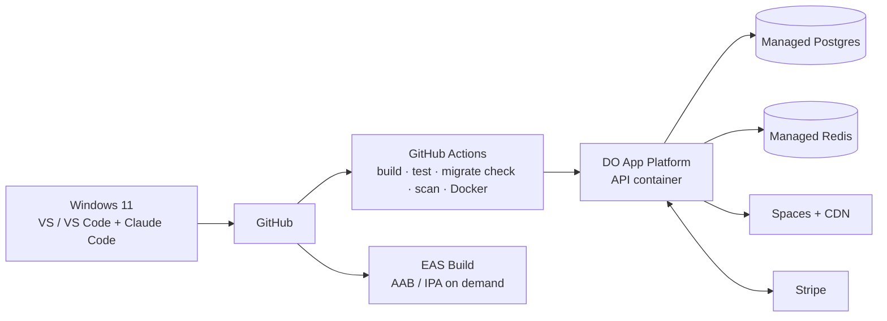

## 10. Cross-cutting concerns

### 10.1 Security

- Passwords: hashed with the Identity default hasher (`PasswordHasher`, v3 PBKDF2, rehash on upgrade); never stored plain or logged.
  - Policy: 8–128 characters, no composition rules (NIST SP 800-63B; Slice 1b D8).
  - Lockout: 5 failures lock the account for 5 minutes. The user row is locked before the password is verified, so parallel guesses can't bypass the count.
  - Unknown and locked accounts get the same response and the same hashing work.
- JWT access token: 15 min, HS256 with an algorithm pin. The key is ≥ 32 bytes from config or a secret store; Development may use an ephemeral key, and any other environment fails to start without one.
- Refresh token: opaque, rotated, stored as a SHA-256 hash, and grouped in families. Reuse of a consumed token revokes the family. Sliding lifetime 14 days, absolute 30 days. Revoked on logout and password reset.
- Per-resource authorization: `GET /orders/{id}` requires owner, Admin, or Support. Another customer's order returns **403** (test 7).
- Validation (FluentValidation) on every write DTO. No mass assignment.
- Rate limits per IP + user on login, register, password reset, checkout, and webhook (the webhook must still accept Stripe retries). Generous limits on catalog reads.
- CORS: configured frontend origins only, never `*` with credentials.

### 10.2 Caching — performance layer, never truth

| Data | Cache | Invalidation |
|---|---|---|
| Product list / detail | Redis 60s, images on CDN | Delete keys on product/variant change |
| Categories | Redis 5 min | On change |
| Stock indicator (display) | Redis 10s | TTL only. Checkout re-reads Postgres under lock |
| Cart, totals, orders, payments | **Never cached** | — |

Redis down → cache-aside falls back to Postgres (slower, correct). Postgres down → no fallback, by design.

### 10.3 Observability

- Every error is Problem Details with `traceId`; no stack traces to clients.
- Correlation ID: taken from the request header or generated, and echoed in the response. Every order log carries `OrderId` + `CorrelationId`. Structured templates only (`Log.Information("Order {OrderId} paid", id)`).
- `/health/live` (process only) and `/health/ready` (Postgres reachable **and** no pending migrations → 200, else 503). Redis, once added (Slice 7), reports `Degraded` only — still 200 — because Redis is never truth (§10.2, rule 4). Traffic routes on Ready.
- Day-one metrics: checkout attempts and success rate, webhook failures, reservation expiries, dead letters, projector lag, p95 checkout latency.

### 10.4 Scaling — planning estimates, not promises

| Stage | Load | Change |
|---|---|---|
| Launch | ~100 orders/day, ~10k views/day | One API container, small managed Postgres, Postgres full-text |
| Growing | ~1k orders/day, ~100k views/day | API replicas (stateless), Redis on, CDN, fix slow queries with indexes before hardware |
| Scaling | ~10k orders/day, ~1M views/day | Workers in their own process (same code, new entry point), read replica for catalog reads, dedicated search only if measured |

**Add a service only when a metric proves the current layer is the bottleneck.** Checkout is write- and lock-heavy and will never scale like reads; keep transactions short and external calls outside them.

### 10.5 Deployment

- Migrations run as a separate, reviewed step before the new version takes traffic. Use expand/contract: add nullable → backfill → require in a later deploy. Never drop a column that the running version reads.
- Rollback = redeploy the previous image against the current schema. A migration that breaks this blocks the deploy.
- No manual production data edits — audited endpoints only.

