# Ecommerce Architecture — Deep Build with Claude Code

## How to use this file

This is the single source of truth for the ecommerce build. Give it to Claude Code first, before any code is written, and tell Claude:

> Read `ecommerce-architecture.md` first. Do not change the stack, the module boundaries, or the checkout invariants in this file. If a request conflicts with this file, stop and ask. Build one slice at a time, in slice order, and do not start the next slice until the current slice's tests pass.

This file is for **learning deeply and building production-ready code**, not for a demo CRUD app. The goal is a system you can defend in a staff-engineer interview: tradeoffs, failure modes, and what breaks at 10x.

---

## 1. Context — why this app, and who it is for

**Builder:** Nathaniel, Sr. Software Developer at Henderson Engineers (Digital Innovations, Lenexa, KS). Windows 11 PC, no Mac.

**Goal:** Become a staff software engineer by mastering system design and building scalable, maintainable, resilient systems. This ecommerce app is the practice vehicle for that goal, and also an interview anchor story: a familiar domain where the interviewer can skip domain explanation and go straight to the hard parts.

**Important history, do not lose it:**
- Nathaniel already built ecommerce before using Claude / AI. Repeating the familiar parts has diminishing returns. The value here is **depth, not breadth**: inventory races, idempotent payments, reservation expiry, outbox delivery, and failure handling — the parts that are easy to fake in a demo and hard to get right in production.
- On 2026-11-01 an interactive ecommerce architecture diagram was delivered around a one-codebase Expo + React Native Web frontend (web + Android + iOS, store-ready but not submitted).
- **Frontend decision, updated 2026-11-02:** This build now uses that **one-codebase Expo frontend**, not React web only. The backend in this file is unchanged in shape, so the API and modules do not need a redesign — only Section 5 and the frontend rows in Sections 2 and 13 change. Store submission is still NOT in scope: the Android/iOS builds are store-ready (signed AAB/IPA, store configs, pipelines) so submission is possible later, without submitting yet.

**What "done" means:**
- A customer can browse, search, add to cart, check out, pay, get an order confirmation, track fulfillment, and request a return — with no oversell, no double charge, and no lost order on crash or webhook retry.
- An admin can manage products, inventory, orders, and customers.
- Every hard invariant below has a failing test first, then code that makes it pass.

**What this is NOT:**
- Not a marketplace (no third-party sellers in v1).
- Not a recommendation engine with ML in v1 (use simple rules: best sellers, related category).
- Not microservices in v1. One deployable API. See Section 3 for why.
- Not a product launch plan. No GTM, pricing, or marketing is decided in this file. This is a deep-study / production-code build.

---

## 2. Stack lock — do not change without explicit approval

| Layer | Choice | Version / notes |
|---|---|---|
| Backend language / framework | C# / ASP.NET Core | .NET 10 |
| ORM | Entity Framework Core | Code-first migrations, Postgres provider |
| Database (system of record) | PostgreSQL | 17. **All money, inventory, and order state lives here. Never in Redis alone.** |
| Cache / rate limit / SignalR backplane (optional) | Redis | 7, cache only. Losing Redis must never lose an order or oversell stock. |
| Frontend | Expo + React Native + React Native Web, TypeScript | ONE codebase for web, Android, and iOS. Expo Router, Metro, TanStack Query, StyleSheet. Web via `expo export --platform web` to CDN, Android via cloud EAS Build to signed AAB (no Android Studio, no local Android SDK), iOS via cloud EAS Build to signed IPA (no Mac needed). Store-ready, not submitted. |
| Frontend state | TanStack Query for server state, Zustand for cart UI state only | Cart truth is re-validated server-side at checkout. Same state code across web, Android, and iOS. |
| Auth | ASP.NET Core Identity + JWT access token + rotating refresh token | Roles: Customer, Admin, Support (read-only orders) |
| Payments | Stripe PaymentIntents + webhooks | Test mode first. No real keys in this file, in code, or in chat |
| Email | Provider-agnostic `IEmailSender` | SMTP / Resend / SendGrid behind the interface. Pick one at deploy time, do not hard-code it |
| Object storage | S3-compatible storage (DigitalOcean Spaces or equivalent) + CDN | Product images only. Never store images in Postgres as blobs |
| Real-time | SignalR | Order status updates to the customer only. Not required for checkout correctness |
| Background jobs | .NET HostedService / Hangfire-style worker inside the monolith | Reservation expiry, outbox publisher, email retries. No separate worker service in v1 |
| Logging / tracing | Serilog + OpenTelemetry | Correlation ID on every request, order ID on every order log |
| Tests | xUnit + Testcontainers (Postgres) + WebApplicationFactory | Integration tests use real Postgres, not in-memory EF |
| Hosting (default) | DigitalOcean App Platform + Managed Postgres + Managed Redis + Spaces | Docker image from CI. Any equivalent host works if it gives managed Postgres + a place to run one API container |
| CI | GitHub Actions | Build, test, migrate check, Docker build. No deploy on red |

**Open decisions left blank on purpose — Claude must NOT invent these:**
- Stripe publishable / secret keys and webhook secret: `________`
- Production domain: `________`
- Email provider and sender address: `________`
- Spaces bucket / CDN domain: `________`

---

## 3. Architecture principles

### 3.1 Modular monolith, not microservices, not layered spaghetti

One API, one database, one deployment — but with **hard module boundaries inside the monolith**. A module is a vertical slice: its own entities, services, repositories, API endpoints, and events. This is the staff-level point: you get most of microservices' isolation without paying for distributed transactions, network failures, and 8 deployments in v1.

Rules Claude must enforce:

1. A module may only read another module's data through that module's **public contract** (interface or published domain event). Never `DbSet` from another module, never a cross-module SQL join in application code.
2. A module owns its tables. No other module writes to them directly.
3. Cross-module side effects go through the **outbox pattern** (Section 8.4). Never call Stripe, email, or another module's write and then hope the transaction commits.
4. If a module needs to be extracted later, it should be extractable by moving its folder + its tables + its public contract. If it cannot be moved cleanly, the boundary is broken.

### 3.2 SOLID, mapped to concrete code (not slogans)

| Principle | How it shows up in this codebase |
|---|---|
| **S — Single Responsibility** | One service does one job: `InventoryReservationService` reserves/releases stock. It does not send email, charge cards, or calculate shipping. `OrderService` orchestrates, it does not own payment gateway code. |
| **O — Open / Closed** | Pricing, shipping, and payment providers are strategies behind interfaces: `IPricingRule`, `IShippingRateProvider`, `IPaymentGateway`. Add a new shipping carrier by adding a class, not by editing `OrderService` if-statements. |
| **L — Liskov Substitution** | Any `IPaymentGateway` (Stripe now, a fake in tests, another gateway later) must be substitutable without changing checkout flow. Same for `IInventoryStore`. If a fake behaves differently in tests than Stripe does in prod, the abstraction is leaking. |
| **I — Interface Segregation** | Small interfaces: `IInventoryReader`, `IInventoryReserver`, `IOrderReader`. A read-only admin view does not depend on a write interface it never uses. No god `IRepository<T>` used everywhere. |
| **D — Dependency Inversion** | Application layer depends on abstractions (`IPaymentGateway`, `IEmailSender`, `IClock`, `IIdempotencyStore`). Infrastructure implements them. Domain layer depends on nothing outside itself. `DateTime.UtcNow` is banned in domain/application code — inject `IClock` so expiry tests are deterministic. |

### 3.3 Production-ready means

- **Correct under concurrency** before it is fast. Oversell and double-charge are bugs, slow search is a tuning task.
- **Idempotent everywhere money or state moves.** Same request twice = same result once.
- **Observable.** If it fails in prod, you can answer: which order, which user, which step, which external call, in under 5 minutes from logs + correlation ID.
- **Recoverable.** Crash mid-checkout, webhook retry, email provider down — the system converges to a correct state by retry / expiry / outbox, without manual database edits.
- **Secure by default.** See Section 10. No trust in client-submitted prices, totals, or discount codes.

---

## 4. System diagram

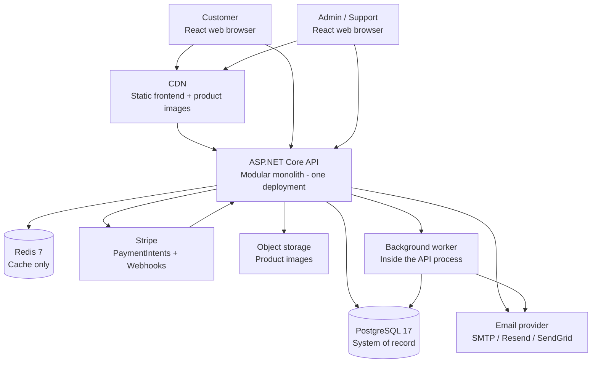

Notes:
- The browser never talks to Postgres, Stripe secret keys, or object storage directly.
- Stripe talks back to the API only via a signed webhook endpoint. That endpoint is the only place a payment can change order state from outside.
- The worker is not a separate service in v1. It is a hosted service in the same process, reading the outbox and expiring reservations.

---

## 5. Frontend architecture — Expo one codebase (web + Android + iOS)

### 5.1 Structure

```
apps/store/            # single Expo app
  app/                 # Expo Router screens: index, products, products/[slug], cart, checkout, orders, orders/[id], admin/*
    features/
      catalog/         # product list, search, product detail hooks + components
      cart/            # cart UI state (Zustand) + server validation hooks
      checkout/        # checkout form, PaymentIntent flow, idempotency key handling
      orders/          # order list, tracking, return request
      admin/           # product/inventory/order management (Admin role only)
    components/        # shared UI: Button, Price, ProductCard, Pagination (React Native components, rendered to DOM on web via React Native Web)
    lib/
      api-client.ts    # typed fetch client, auth token attach, correlation ID header — same client on all platforms
      query-keys.ts    # TanStack Query keys, one source of truth for invalidation
      platform.ts      # only the code that must differ per platform (payments SDK, push, storage) — keep this file tiny
  # No local android/ or ios/ folders required. EAS Build generates them in the cloud.
  # Do not commit android/ or ios/ folders, do not open them in Android Studio or Xcode.
  # Frontend is full React Native: all screens are React Native components, web is those same
  # components rendered via React Native Web. No native Kotlin/Java, no Swift, no Capacitor,
  # no separate React DOM web app.
```

### 5.1a How it deploys to each platform

- **Web:** `expo export --platform web` → static output to CDN / static host. No separate React web app.
- **Android:** Cloud EAS Build → signed AAB. No Android Studio, no local Gradle, no local Android SDK.
- **iOS:** Cloud EAS Build → signed IPA → TestFlight / App Store when ready. No local Xcode, no Mac.
- **Shared vs platform-only:** Screens, cart/order logic, API client, validation, and state are shared. Only payments SDK wiring, push notifications (FCM/APNs), deep links, and native permissions are platform-specific, and they live behind the `lib/platform.ts` boundary.
- **SEO note:** This is a client-rendered React Native Web app, not Next.js. Product pages will be weaker for SEO than a server-rendered storefront in v1. That is an accepted tradeoff for one codebase; a Next.js storefront is the exit if SEO becomes the bottleneck, and it would reuse the same .NET API.
- **Backend unchanged:** All three frontends call the same .NET Core API in Section 2. No per-platform API is needed.

### 5.2 Rules

- **Never trust the client for money.** Prices, totals, discounts, and shipping are calculated server-side at checkout. The frontend shows an estimate, the API returns the authoritative total.
- **Server state via TanStack Query, UI state via Zustand.** Cart items are kept locally for speed, but checkout re-validates price + stock server-side and shows a clear "price/stock changed" step if anything moved.
- **Idempotency key on checkout.** The frontend generates one UUID per checkout attempt and sends it as `Idempotency-Key`. Retry (double-click, network retry) sends the same key and gets the same order, not a second order. See Section 8.2.
- **Optimistic UI only where it is safe.** Cart add can be optimistic. Checkout submit, payment confirm, and return request must not be optimistic — wait for the server result.
- **Accessibility + performance budgets (v1 targets, not guarantees):** product list renders without a full-page reload on filter change, images lazy-loaded with width/height to avoid layout shift, no page ships more than one large hero image unoptimized.

### 5.3 Routes (v1)

| Route | Who | Purpose |
|---|---|---|
| `/` | Public | Home, best sellers, categories |
| `/products?search=&category=&sort=&page=` | Public | Search + filter + pagination, server-driven |
| `/products/:slug` | Public | Detail, variants, stock indicator, reviews |
| `/cart` | Customer (guest cart allowed, merged on login) | Review, update qty, remove |
| `/checkout` | Customer | Address, shipping method, payment (Stripe), review authoritative total |
| `/orders`, `/orders/:id` | Customer | History, status timeline, tracking, return request |
| `/admin/products`, `/admin/orders`, `/admin/inventory` | Admin | CRUD, stock adjust with audit reason, order status override with audit |

Guest cart: stored locally, merged into the user cart on login by server rule — same product + variant sums quantity, capped at available stock, never silently drops items without showing the merge result.

---

## 6. Backend — modular monolith diagram

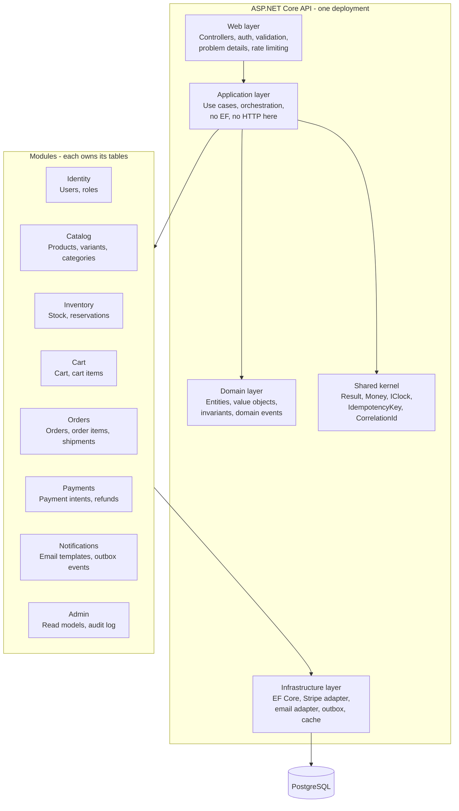

### 6.1 Module table — responsibility, owns, must never do

| Module | Owns / responsible for | Public contract (what others may call) | Must NEVER do |
|---|---|---|---|
| Identity | Users, password hashing (Identity), roles, refresh tokens | `IUserReader`, `ICurrentUser` | Store order or payment data |
| Catalog | Products, variants, categories, images metadata, search index data, reviews | `IProductReader`, `ProductPublished` event | Change stock. That is Inventory. |
| Inventory | Stock levels, reservations, release, decrement on paid order | `IInventoryReader`, `IInventoryReserver` (reserve / release / commit) | Charge a card or create an order |
| Cart | Guest + user carts, merge on login, cart validation snapshot | `ICartReader`, cart validated snapshot for checkout | Calculate final tax/shipping. That is Orders/Pricing at checkout time. |
| Orders | Order aggregate, totals, tax, shipping, status machine, shipments, returns | `IOrderReader`, `OrderPlaced`, `OrderPaid`, `OrderShipped` events | Call Stripe directly. That is Payments via interface. |
| Payments | Stripe PaymentIntent creation, webhook handling, refunds, idempotency | `IPaymentGateway` (create intent, refund), `PaymentSucceeded` / `PaymentFailed` events | Change inventory or order items. It only reports payment outcome. |
| Notifications | Email templates, outbox dispatch, SignalR order updates | Consumes domain events only | Write order state |
| Admin | Admin read models, stock adjust with reason, audit log | Reads via other modules' readers | Bypass module contracts to edit tables directly |

### 6.2 Layer rules per module

```
src/
  Ecommerce.Domain/          # no dependencies on EF, ASP.NET, Stripe
    Catalog/ Orders/ Inventory/ Payments/ Identity/ Shared/
  Ecommerce.Application/     # depends on Domain only + abstractions
    Catalog/ Orders/ Inventory/ Payments/ ...
  Ecommerce.Infrastructure/  # EF Core, Stripe, email, Redis, outbox, clock
  Ecommerce.Api/             # controllers, middleware, auth, DI wiring
  Ecommerce.Web/             # (see Section 5, separate Vite app)
tests/
  Ecommerce.Domain.Tests/
  Ecommerce.Application.Tests/
  Ecommerce.Api.IntegrationTests/   # Testcontainers Postgres
```

Dependency direction is one-way: Api -> Application -> Domain. Infrastructure -> Application (implements its interfaces). Domain -> nothing. If a using statement points the wrong way, the slice is wrong.

---

## 7. Data model

Postgres is the system of record. Use `numeric(19,4)` for money, never `float`/`double`. Store currency with every money amount. Use UTC timestamps (`timestamptz`).

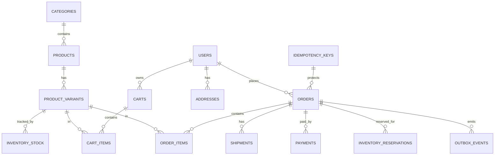

### 7.1 Core tables (v1, simplified — migrations are the source of truth)

**users** (via ASP.NET Core Identity tables, plus profile): id, email (unique, citext), display_name, created_at.
**addresses:** id, user_id, label, full_name, line1, line2, city, region, postal_code, country, is_default.
**categories:** id, slug (unique), name, parent_id (nullable, one level in v1).
**products:** id, slug (unique), name, description, category_id, is_active, created_at, updated_at.
**product_variants:** id, product_id, sku (unique), name (e.g. "Black / Large"), price (numeric), compare_at_price (nullable), weight_grams, is_active.
**product_images:** id, product_id, storage_key, alt_text, sort_order.
**inventory_stock:** product_variant_id (PK), quantity_on_hand, quantity_reserved, version (rowversion / xmin for optimistic checks). Invariant: `quantity_on_hand - quantity_reserved >= 0` always, enforced in DB with a check constraint, not just in code.
**inventory_reservations:** id, order_id, product_variant_id, quantity, status (Active, Committed, Released, Expired), expires_at, created_at. Unique partial index: one active reservation per (order_id, variant_id).
**carts:** id, user_id (nullable for guest), session_key, created_at, updated_at.
**cart_items:** id, cart_id, product_variant_id, quantity, added_at. Unique (cart_id, variant_id).
**orders:** id, order_number (human readable, unique, e.g. ORD-2026-000123), user_id, status, subtotal, discount_total, shipping_total, tax_total, grand_total, currency, shipping_address_snapshot (jsonb), billing_address_snapshot (jsonb), idempotency_key (unique), stripe_payment_intent_id (unique, nullable), created_at, updated_at.
**order_items:** id, order_id, product_variant_id, sku_snapshot, name_snapshot, unit_price_snapshot, quantity. Prices are snapshots — changing a product price later must never rewrite history.
**order_status_history:** id, order_id, from_status, to_status, changed_by, reason, created_at. Every status change is audited.
**payments:** id, order_id, provider, provider_payment_id (unique), amount, currency, status (RequiresAction, Succeeded, Failed, Refunded, PartiallyRefunded), created_at.
**shipments:** id, order_id, carrier, tracking_number, status, shipped_at, delivered_at.
**outbox_events:** id, aggregate_type, aggregate_id, event_type, payload (jsonb), created_at, published_at (nullable), attempts. Publisher marks published only after successful dispatch.
**idempotency_keys:** key (PK), user_id, request_hash, response_body (jsonb), created_at, expires_at. Used for checkout and for Stripe webhook event IDs.
**audit_log:** id, actor_id, entity_type, entity_id, action, before_json, after_json, created_at. Used for admin stock adjusts and order overrides.

### 7.2 Indexes that matter on day one

- `products(slug)`, `products(category_id, is_active)`, full-text index on product name + description (Postgres `tsvector`, generated column).
- `product_variants(sku)`, `product_variants(product_id)`.
- `orders(user_id, created_at DESC)`, `orders(idempotency_key)`, `orders(stripe_payment_intent_id)`.
- `inventory_reservations(expires_at) WHERE status = 'Active'` — for the expiry job.
- `outbox_events(published_at) WHERE published_at IS NULL` — for the publisher job.
- `order_items(order_id)`, `cart_items(cart_id)`.

### 7.3 Order status machine — the only allowed transitions

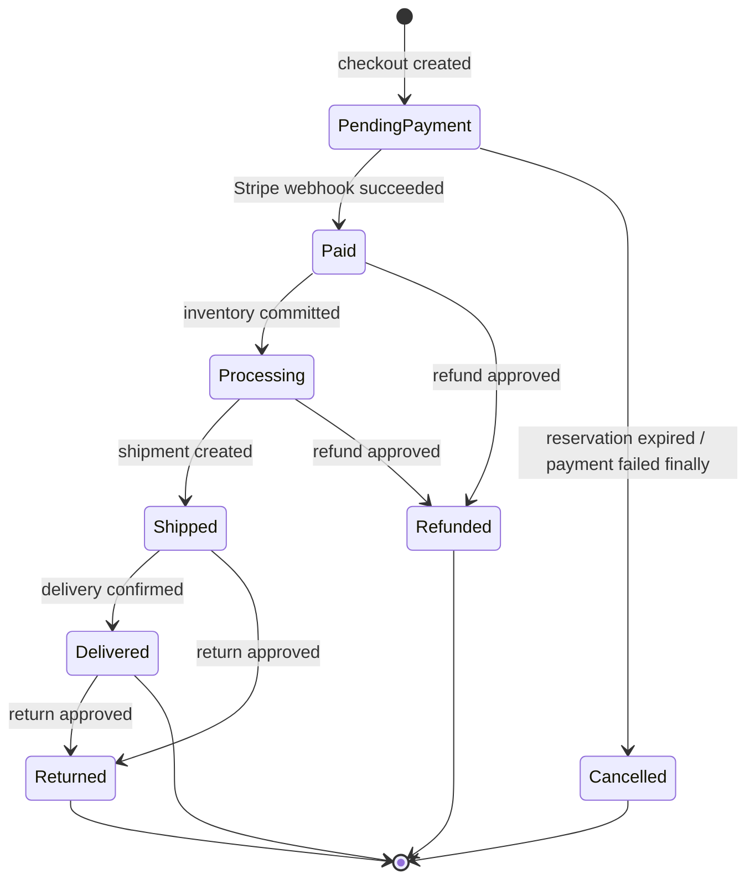

Any transition not in this diagram is rejected by the domain, not just by the UI. The UI hiding a button is not a security control.


---

## 8. Workflows and workflow diagrams

Read these before writing checkout, payment, or inventory code. If code contradicts a diagram, the diagram wins until the diagram is explicitly updated and the test is updated with it.

### 8.1 Browse, search, add to cart

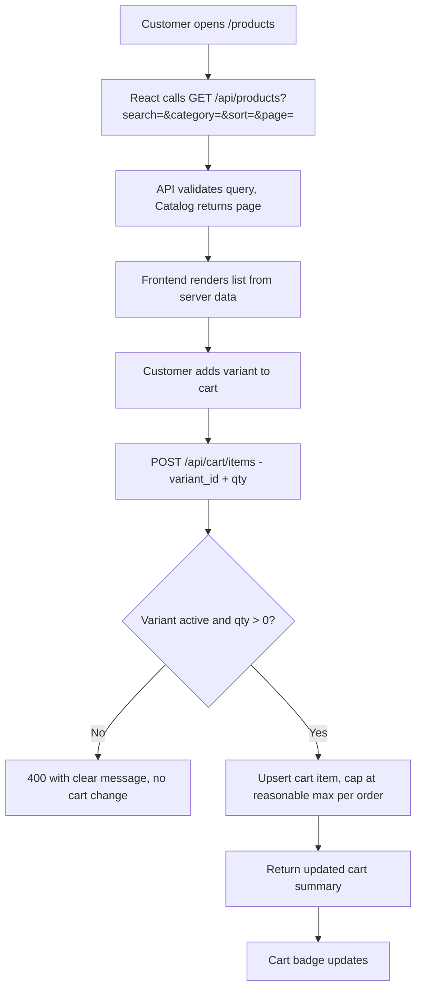

Search notes:
- Search is server-side, paginated, never "load all products and filter in the browser."
- Sort options in v1: relevance (full-text rank), price asc/desc, newest. No sort may bypass pagination.
- Stock indicator on product detail comes from Inventory reader (available = on_hand - reserved), cached briefly in Redis, but checkout always re-checks Postgres.

### 8.2 Checkout — the core workflow (read this twice)

This is the workflow the whole build is judged on. It must survive double-click, network retry, browser refresh after payment, Stripe webhook arriving twice, and a crash between any two steps.

**Invariants (non-negotiable):**
1. One checkout attempt (one idempotency key) creates at most one order.
2. One Stripe PaymentIntent is linked to at most one order.
3. Stock is never oversold: committed quantity can never exceed on-hand quantity.
4. Client-submitted totals are ignored. The server recalculates subtotal, discount, shipping, and tax from current catalog + inventory + shipping rules.
5. A reservation that is not paid within its TTL is released automatically, so stock is not held hostage by abandoned checkouts.
6. Payment success without an order, or an order without a payment record, must be impossible to end in — webhook handling reconciles both.

**Reservation TTL:** 15 minutes in v1. Long enough to complete Stripe payment, short enough to free stock quickly. Make it a config value, not a hard-coded magic number.

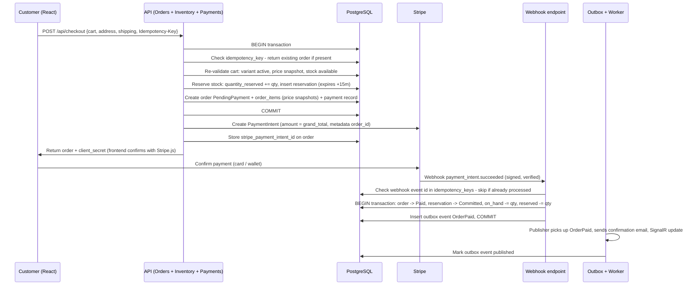

**Step-by-step, in plain language:**

1. **Idempotency check first.** If the idempotency key already has an order, return that order. Do not create a second one, do not charge again.
2. **Validate in one Postgres transaction.** Lock the inventory rows you need (`SELECT ... FOR UPDATE` on `inventory_stock` for the variants in the cart, in a consistent order to avoid deadlocks). Check active + available stock. If any line fails, roll back everything and return a precise error: which item, why (out of stock, price changed).
3. **Reserve, do not decrement yet.** `quantity_reserved` goes up, `quantity_on_hand` stays until payment succeeds. Insert a reservation row with `expires_at = now + 15 minutes`.
4. **Create the order as PendingPayment** with price snapshots. The order total is the server total, not the frontend total.
5. **Create the Stripe PaymentIntent after the transaction commits.** If PaymentIntent creation fails, the order stays PendingPayment and the reservation will expire, or the customer can retry payment on the same order — never create a second order for the retry.
6. **Frontend confirms payment with Stripe.js.** The secret key never leaves the server. The frontend only ever sees `client_secret`.
7. **Webhook is the source of truth for payment success.** Do not mark an order Paid just because the frontend says payment succeeded. The frontend result is a hint; the signed webhook is the proof.
8. **Webhook handling is idempotent.** Store the Stripe event ID in `idempotency_keys`. Second delivery of the same event is a no-op with a 200 response (Stripe retries webhooks — a 500 on duplicate would cause an infinite retry loop).
9. **Commit inventory only on Paid.** In the same transaction as the status change: reservation Committed, `on_hand -= qty`, `reserved -= qty`, status history row inserted.
10. **Side effects via outbox only.** Confirmation email, SignalR update, and any future fulfillment trigger are outbox events published after commit, not inline calls inside the payment transaction. If email is down, the order is still Paid and the email retries from the outbox.

### 8.3 Inventory race — why this diagram exists

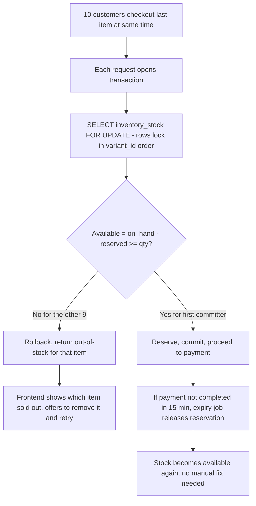

Test that proves it (write this test before the code): 10 parallel checkout attempts for 1 unit in stock must produce exactly 1 successful reservation, 9 clean failures, and `on_hand - reserved` must never go negative.

### 8.4 Outbox pattern — how side effects survive a crash

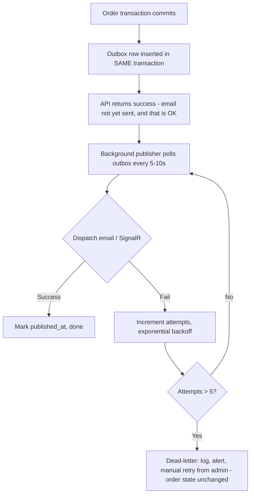

Why not "just send email in the controller"? If the email call fails after the order commits, you have a paid order with no confirmation and no record that email was supposed to go out. If email succeeds and the transaction then rolls back, you sent a confirmation for an order that does not exist. Outbox removes both failure modes.

### 8.5 Payment failure, cancellation, and refund

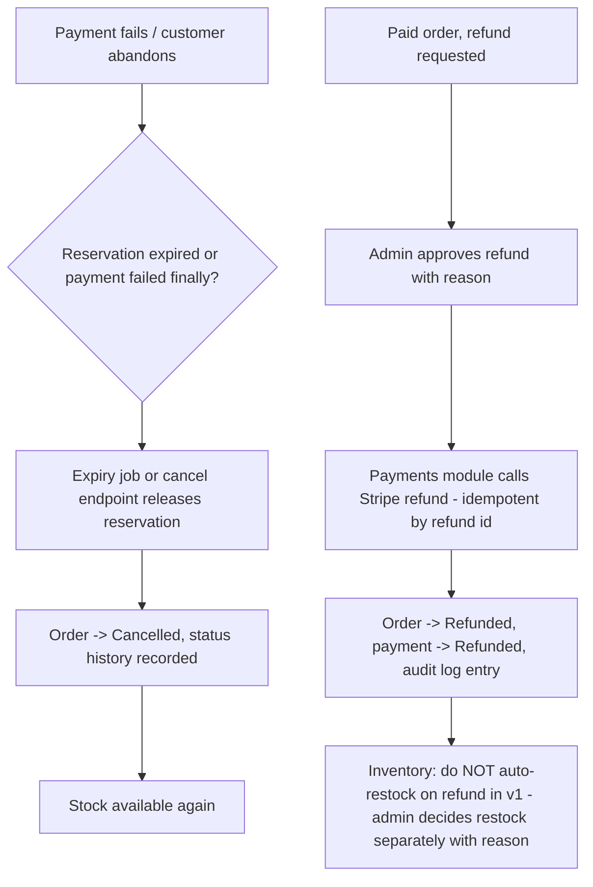

Rules:
- A refund never deletes an order or rewrites its totals. It adds a payment record and a status change.
- Restock on return/refund is an explicit admin action with a reason, so inventory audits stay honest.

### 8.6 Fulfillment workflow

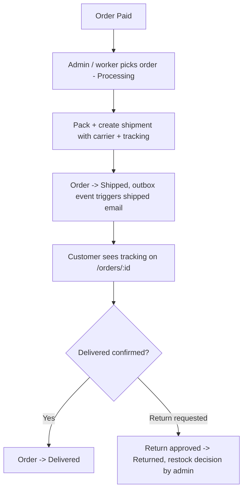

In v1, fulfillment is manual admin action, not an automatic warehouse integration. The status machine and audit trail are the point — automation can plug into the same transitions later.

### 8.7 Admin product and inventory workflow

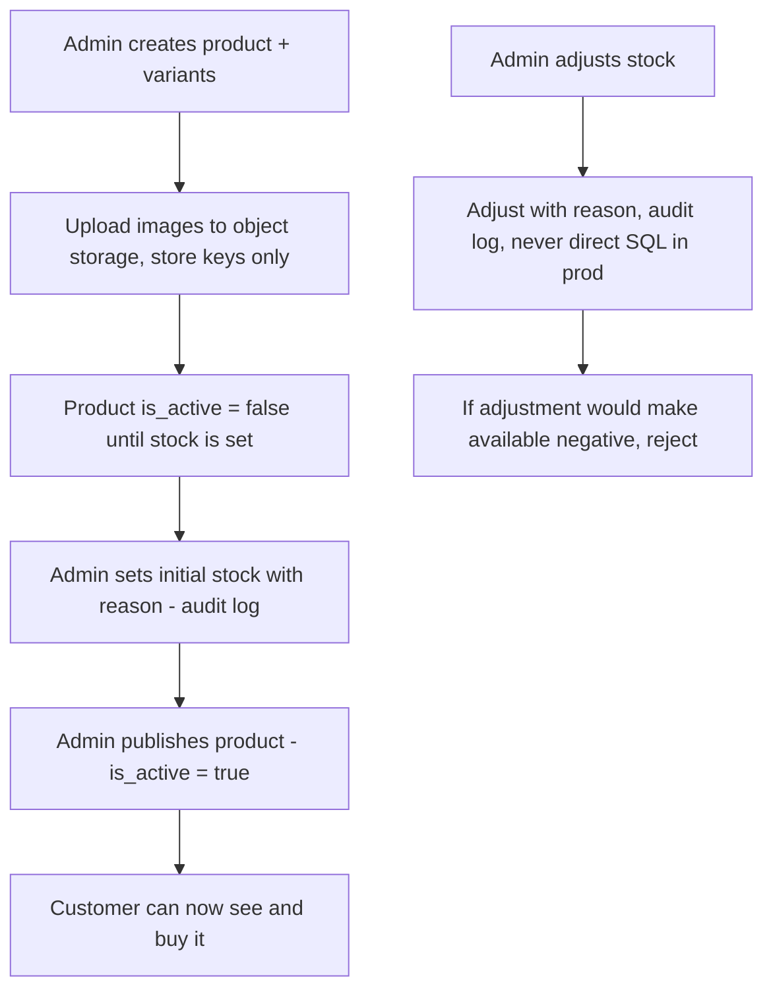

---

## 9. API surface (v1)

Base: `/api/v1`. All responses use Problem Details (`application/problem+json`) on errors. All list endpoints are paginated (`page`, `pageSize`, max 100) and return total count. Auth: `Authorization: Bearer <access_token>` except public catalog reads and Stripe webhook (signed, not Bearer).

| Method + path | Role | Purpose / notes |
|---|---|---|
| `GET /api/v1/products?search=&category=&sort=&page=&pageSize=` | Public | Search, filter, paginate |
| `GET /api/v1/products/{slug}` | Public | Detail + variants + images + stock indicator |
| `GET /api/v1/categories` | Public | Category tree |
| `POST /api/v1/cart/items` | Customer / guest | Add or update qty. Body: variant_id, quantity |
| `GET /api/v1/cart` | Customer / guest | Current cart with server-validated prices |
| `DELETE /api/v1/cart/items/{variantId}` | Customer / guest | Remove line |
| `POST /api/v1/checkout` | Customer | Header `Idempotency-Key` required. Creates PendingPayment order + reservation, returns PaymentIntent client_secret |
| `POST /api/v1/orders/{id}/retry-payment` | Customer (owner) | Reuse same order, create new PaymentIntent if previous expired/failed. Never creates a second order |
| `GET /api/v1/orders`, `GET /api/v1/orders/{id}` | Customer (owner) | History + detail + status timeline |
| `POST /api/v1/orders/{id}/return-request` | Customer (owner) | Return request, admin approves separately |
| `POST /api/v1/webhooks/stripe` | Stripe (signed) | Payment outcome only. Verify signature, check event idempotency, then apply transition |
| `GET /api/v1/admin/products`, `POST /api/v1/admin/products`, `PUT /api/v1/admin/products/{id}` | Admin | Product management |
| `POST /api/v1/admin/inventory/adjust` | Admin | Stock adjust with reason, audited |
| `GET /api/v1/admin/orders`, `POST /api/v1/admin/orders/{id}/ship`, `POST /api/v1/admin/orders/{id}/refund` | Admin | Fulfillment + refund, audited |

Versioning: `/api/v1` stays stable. Breaking changes go to `/api/v2`, v1 is not silently changed.


---

## 10. Cross-cutting concerns — production-ready checklist in code

### 10.1 Auth, authorization, and security (OWASP-minded)

- Passwords: ASP.NET Core Identity defaults (hashed, never plain text, never logged).
- JWT: short-lived access token (15 min), rotating refresh token stored hashed, revoked on logout / password change.
- Authorization is enforced in the API per endpoint **and** per resource: a customer can only read their own orders/cart. `GET /orders/{id}` checks `order.user_id == current_user_id` or Admin role. Frontend hiding a link is not authorization.
- Input validation: FluentValidation or data annotations on every write DTO. Reject unknown fields that change price/total/status.
- No mass assignment: DTOs are explicit. An order DTO has no `grand_total` or `status` field a client can set.
- Stripe webhook: verify signature with the webhook secret, reject unsigned requests, return 200 only after idempotent processing (or intentional skip of a duplicate).
- Rate limiting: checkout and login endpoints rate-limited per IP + per user. Catalog reads have a higher, generous limit.
- CORS: allow only the frontend origin(s) in config, never `*` with credentials.
- Secrets: environment variables / secret manager only. No keys in git, no keys in this file.
- Audit: admin stock adjusts, order status overrides, and refunds always write to `audit_log` with actor, before, and after.

### 10.2 Caching strategy — cache is a performance layer, never a truth layer

| Data | Cache | Invalidation |
|---|---|---|
| Product list / detail | Redis, 60s, plus CDN for images | On product/variant update, delete those keys. Stale product name for 60s is acceptable; stale stock at checkout is not — checkout never reads cache for stock |
| Categories | Redis, 5 min | On category change |
| Stock indicator (display only) | Redis, 10s | Display only. Checkout re-reads Postgres with a lock |
| User cart, order totals, payment state | **No cache** | Always Postgres |

If Redis is down, the API must still work (cache-aside with fallback to Postgres), just slower. If Postgres is down, there is no fallback — that is correct, because Postgres is the truth.

### 10.3 Errors, logging, and observability

- Every API error returns Problem Details: `type`, `title`, `status`, `detail`, `traceId`. No stack traces to the client.
- Every log line for an order flow includes `order_id` and `correlation_id`. Correlation ID comes from the request header if present, otherwise generated, and is returned in the response header.
- Health endpoints: `/health/live` (process up) and `/health/ready` (Postgres + Redis reachable). The host uses Ready for traffic routing.
- Metrics to expose from day one (even if the dashboard comes later): checkout attempts, checkout success rate, payment webhook failures, reservation expiries, outbox dead-letters, p95 checkout latency. If outbox dead-letters > 0, that is an alert, not a log line to ignore.
- Structured logging with Serilog: log events, not string concatenation. `Log.Information("Order {OrderId} paid", orderId)` — never log card numbers, Stripe secrets, passwords, or full JWTs.

### 10.4 Performance and scaling — back-of-envelope (planning estimates, not guarantees)

Assume a small store to start, then scale in steps. These numbers are for reasoning, not promises:

| Stage | Rough load | What changes |
|---|---|---|
| v1 launch | ~100 orders/day, ~10k product views/day | Single API container, managed Postgres (small), Redis optional. Postgres full-text search is enough. No extra services. |
| Growing | ~1,000 orders/day, ~100k views/day | Add API container replicas (stateless API makes this safe), Redis cache on, CDN for images, read the slow queries from Postgres logs and add the missing index before adding hardware. |
| Scaling | ~10,000 orders/day, ~1M views/day | Separate the outbox publisher / expiry worker into its own process (same code, different entry point), Postgres read replica for catalog reads only (writes still go to primary), consider dedicated search (OpenSearch) only when full-text ranking or faceting actually becomes the bottleneck — measured, not guessed. |

Scaling rule for this build: **do not add a service until a metric proves the current layer is the bottleneck.** Adding Kafka, Elasticsearch, or microservices on day one is not "production-ready," it is premature complexity that hides the real invariants.

Checkout math to keep in mind: checkout is write-heavy and lock-heavy by nature. It will never scale like a product list read. That is why reservations are short-lived, locks are held for the shortest transaction possible, and no external call (Stripe, email) happens inside the Postgres checkout transaction.

### 10.5 Deployment diagram

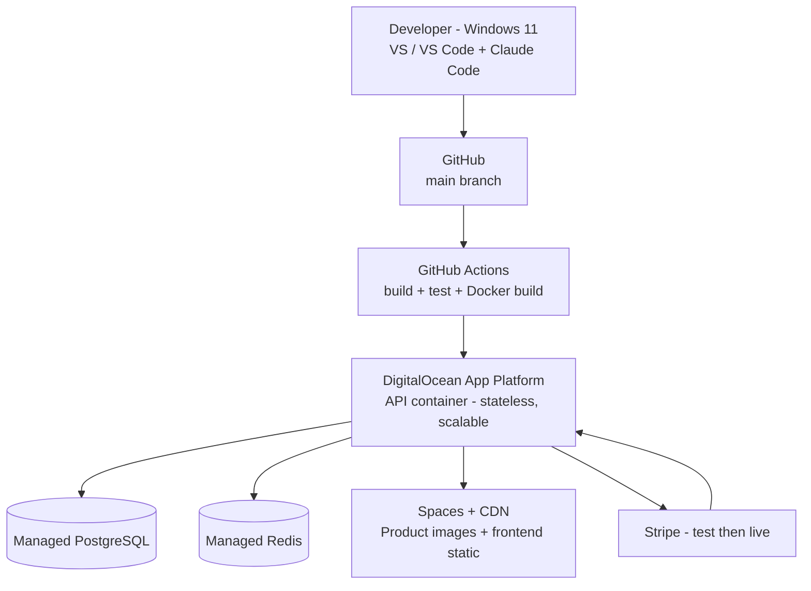

Deploy rules:
- Migrations run as a separate, reviewed step before the new API version serves traffic, and are backward-compatible (add column nullable first, backfill, then make required in a later deploy). No migration may drop a column the old code still reads in the same deploy.
- Rollback = redeploy previous Docker image. Database migrations in v1 must be rollback-safe or the deploy is blocked until they are.
- No manual production data edits except through an audited admin endpoint. If you need SQL in prod, you need a reason in the audit log.

---

## 11. Testing strategy — prove the hard parts, not just the happy path

### 11.1 Test pyramid for this build

- **Domain unit tests (fast, many):** order status machine rejects illegal transitions, money calculations round correctly, pricing rules apply in the right order.
- **Application tests (medium):** checkout orchestration with fakes for Stripe/email, reservation expiry logic with a fake clock.
- **Integration tests (slower, fewer but mandatory):** WebApplicationFactory + Testcontainers Postgres. Real transactions, real locks, real webhook signature verification with a test secret. These are the tests that catch oversell and double-charge.

### 11.2 The 10 tests that must exist before v1 is called done

1. 10 parallel checkouts for 1 unit in stock → exactly 1 reservation succeeds, 9 fail cleanly, available never goes negative.
2. Same checkout idempotency key sent twice → exactly 1 order, 1 PaymentIntent link.
3. Same Stripe webhook event delivered twice → order transitions once, email outbox event created once.
4. Reservation expires after TTL → stock released, order Cancelled, customer can retry.
5. Client sends a fake lower total → server total wins, PaymentIntent amount equals server total.
6. Product price changes after order placed → order item snapshot unchanged.
7. Customer A cannot read, cancel, or refund customer B's order (403, not 404 leak or success).
8. Payment succeeds but API crashes before webhook → webhook retry reconciles order to Paid without a duplicate order.
9. Email provider down → order still Paid, outbox retries, email eventually sent, no duplicate email on retry.
10. Admin stock adjust to a negative available quantity → rejected, audit log shows the attempt and the actor.

Write the failing test first for tests 1, 2, 3, and 4. That is the deep-learning part: if you cannot write the test, you do not yet understand the invariant.

---

## 12. How to build this deeply with Claude Code

This section is the difference between "Claude built an ecommerce app for me" and "I learned to design a production system with Claude's help." Follow it literally.

### 12.1 Who owns what

| Owner | Work |
|---|---|
| **You (Nathaniel)** | This architecture file, the 1-page spec per slice, the hard invariants and their failing tests, review of every diff, the tradeoff decisions in Section 13 |
| **Claude Code** | Boilerplate, CRUD scaffolding, DTOs, migrations from your approved schema, seed data, routine tests, refactoring that does not change behavior |
| **Neither, without a test** | Checkout, inventory reservation, payment webhook handling, refund logic |

### 12.2 Rules for Claude (paste these into your first Claude prompt)

1. Read `ecommerce-architecture.md` first. Do not change stack, module boundaries, or checkout invariants.
2. Build one slice at a time, in the order in Section 12.3. Do not start the next slice until the current slice's tests pass and I have reviewed the diff.
3. Use plan mode first for any slice that touches Orders, Inventory, or Payments. Return risks only, no code, until I approve the plan.
4. Never invent Stripe keys, secrets, domains, or email providers. Leave them as config placeholders.
5. Never add a new NuGet package, external service, or database without asking and naming what it replaces.
6. Never put business logic in controllers. Controllers validate, call application services, and map to responses.
7. Every new public method that moves money or stock gets a test in the same slice, not "later."
8. If my request conflicts with this file, stop and tell me the conflict. Do not silently pick the easier path.

### 12.3 Slice plan — build in this order

| Slice | What | Done when |
|---|---|---|
| 0. Foundation | Solution structure (Domain / Application / Infrastructure / Api / Web), DI wiring, Postgres + migrations pipeline, health endpoints, Serilog + correlation ID, CI build passes | `dotnet test` passes, `/health/ready` returns 200 with Postgres up |
| 1. Identity + Catalog (read) | Users, roles, products, variants, categories, product list/detail/search with Postgres full-text | Public can browse/search/paginate, admin can create a product (no stock yet) |
| 2. Inventory | Stock table, reservation, release, expiry job, available calculation, check constraint | Test 1 (parallel oversell) passes |
| 3. Cart | Guest + user cart, merge on login, server validation snapshot | Cart survives login merge without silent drops |
| 4. Checkout + Payments (the core) | Idempotent checkout, reservation in transaction, Stripe PaymentIntent, signed webhook, Paid transition + inventory commit, outbox | Tests 2, 3, 4, 5, 8 pass |
| 5. Orders + Fulfillment | Order history, status timeline, admin ship, tracking, status machine enforcement | Illegal transition rejected in domain test + API test |
| 6. Notifications + Returns/Refunds | Outbox publisher, confirmation/shipped emails, SignalR order updates, return request + admin refund flow | Tests 9, 10 pass, no duplicate email on retry |
| 7. Hardening | Rate limiting, admin audit log, caching per Section 10.2, performance pass on slow queries, production deploy checklist | Section 14 checklist is green, deploy to DigitalOcean staging works end-to-end |

Do not skip to Slice 4. The slices before it are what make Slice 4 testable.

### 12.4 Verbatim starter prompts (copy, do not paraphrase away the constraints)

**First prompt:**
> Read ecommerce-architecture.md in this repo. Build Slice 0 only: solution structure, DI, Postgres migrations pipeline, health endpoints, Serilog with correlation ID. Do not build catalog, cart, or checkout yet. Return the files changed and the test command result.

**Plan-mode challenge for Slice 4 (before any checkout code):**
> In plan mode only, no code: challenge the checkout design in ecommerce-architecture.md Section 8.2. Tell me where a double order can still happen, where stock can still be oversold, where a payment can succeed without an order, and where an email can be lost or duplicated. Return risks only, do not change the stack, schema, or slice order.

**Failing test first:**
> Write the failing test for 10 parallel checkouts for 1 unit in stock (Section 11, test 1) using Testcontainers Postgres. Do not write the implementation yet. Show me the test failing for the right reason.

### 12.5 Review checklist — use it on every Claude diff

- [ ] Does this change respect module boundaries (no cross-module DbSet)?
- [ ] Does it add a test for money/stock movement?
- [ ] Does it use `IClock`, not `DateTime.UtcNow`, in domain/application code?
- [ ] Are prices/totals calculated server-side, never trusted from the client?
- [ ] Is there an idempotency or outbox consideration if this moves state externally?
- [ ] Can I explain this diff in an interview without reading Claude's explanation back?

If you cannot explain it, do not merge it. Ask Claude to explain it in plain language, then rewrite the part you do not own until you can.

---

## 13. Tradeoffs — the decisions you should be able to defend

### 13.0 Overall reasoning

This stack was not chosen to be fashionable. It was chosen for one builder, Nathaniel, with three constraints that decide almost everything else:

1. **His staff path is .NET.** He is a Sr. Software Developer at Henderson on React/TypeScript and .NET/C#, and his staff goal is in .NET, not in learning a second backend language at the same time as system design. Depth in one stack beats shallow breadth in three.
2. **He is solo, on Windows 11, with no Mac.** Any stack that needs three frontends, a Mac for iOS, or a team to run microservices fails on day one, no matter how good it looks on paper.
3. **The learning point is correctness under failure, not feature count.** Checkout, inventory, payments, and notifications must survive concurrency, retries, and crashes. Every stack choice below is judged first on whether it makes those invariants easier or harder to prove, and only second on speed or novelty.

If any of those three constraints changes, the stack should be re-argued, not blindly kept. That is the interview-ready way to defend it: "I chose X because of these constraints, I gave up Y, and I would change to Z when this metric or constraint changes."

### 13.1 Stack reasoning and tradeoffs — technology by technology

**Backend: .NET 10 / ASP.NET Core / C# — chosen**
- Reasoning: This is Nathaniel's working stack and his interview stack. Strong typing catches contract errors at compile time, ASP.NET Core is fast and mature for APIs, built-in dependency injection, middleware, and Identity fit this app without extra frameworks, and the .NET hiring market for staff roles is far larger than for a niche backend language. Performance is more than enough for v1 to scaling stages in Section 10.4, and Docker makes a Windows-built API deploy cleanly to Linux.
- Tradeoff given up: The JavaScript/TypeScript backend ecosystem (a huge npm library set, and one language across frontend and backend) and the startup speed of a batteries-included Python framework. C# also has a smaller pool of copy-paste ecommerce starters than Node, so more code is written deliberately, which is a cost in speed but a benefit for learning.
- Rejected: Node/Express (would split his depth and lose .NET staff leverage), Python/Django (not his target staff path), Rust (Gabbex's backend is now Rust, but Rust is not his staff goal, has a steeper learning curve for this build, and has a smaller staff .NET-equivalent job market), Java/Spring (similar power, but not his background, so every hour would go to language friction instead of system design).
- Would change when: He deliberately targets a non-.NET staff role, or a future product needs a specific ecosystem .NET cannot serve well.

**ORM and data access: Entity Framework Core, code-first — chosen**
- Reasoning: Migrations are versioned with the code, LINQ covers most reads cleanly, transactions and change tracking fit the checkout flow, and the Postgres provider supports the locking and constraints this build depends on. It keeps the domain model as the source of truth, which matches the modular monolith in Section 3.
- Tradeoff given up: Raw SQL control and visibility. EF can hide expensive queries, cause N+1 reads, and generate SQL that looks fine until load grows. That is why this build requires slow-query review in Slice 7, explicit `FOR UPDATE` locking where it matters, and integration tests on real Postgres instead of trusting in-memory behaviour.
- Rejected: Dapper alone (faster and more explicit, but every query, migration, and mapping is hand-written, which slows a solo builder and adds places to get transactions wrong), a document database as primary store (see Postgres below).

**Database: PostgreSQL 17 as the system of record — chosen**
- Reasoning: ACID transactions are the foundation of the whole checkout story. One transaction can reserve stock, create the order, and insert the outbox event, or roll all of it back. Row-level locks (`SELECT ... FOR UPDATE`), check constraints (available can never go negative), unique constraints (idempotency keys, SKUs), and full-text search cover the hard parts without adding another service. Managed Postgres on DigitalOcean gives backups and patching without running a database server by hand.
- Tradeoff given up: Horizontal write scaling. Postgres scales vertically first, then with read replicas for catalog reads, then with sharding or a different store only when metrics prove it. It is also not SQL Server, which Henderson uses, so dialect details (locking hints, full-text syntax, migration SQL) differ even though the transaction, locking, and constraint concepts transfer directly.
- Rejected: MongoDB or another document store as primary (flexible schema, but weaker relational integrity for money and stock, no check-constraint equivalent for "available never negative" in the same simple way, and transactions across documents are harder to reason about for a solo builder), SQL Server in this build (a valid choice and closer to Henderson, but managed Postgres on DigitalOcean is simpler and cheaper for a solo learning build, and its full-text and JSON support fit v1 without extra services).
- Would change when: Read load or write load provably exceeds one primary plus read replicas, or a future product needs a workload Postgres genuinely cannot serve (for example, a dedicated search or analytics engine, added beside Postgres, not instead of it).

**Cache and rate limiting: Redis 7, cache only — chosen**
- Reasoning: Catalog reads, category lists, and stock indicators are read-heavy and cache well. Redis also gives a clean place for rate-limit counters and, later, a SignalR backplane if the API runs as multiple replicas. It is fast, simple to reason about, and managed, so it adds almost no operations burden.
- Tradeoff given up: Simplicity of having no second service at all. Cache invalidation is a real bug source (stale product name for 60 seconds is acceptable, stale stock at checkout is not), and every cache read needs a fallback to Postgres when Redis is down.
- Rejected: Redis as the lock or as the truth for inventory (if Redis is flushed, restarted, or evicted, stock truth would be lost and oversell would follow — that is exactly the failure this build is designed to prevent), in-memory cache only (breaks as soon as there are two API replicas, because each replica would have a different view of the cache).
- Rule that makes this safe: Checkout never reads stock from cache. It always re-reads Postgres with a lock. Cache is a performance layer, never a truth layer.

**Frontend: Expo + React Native + React Native Web, one codebase — chosen**
- Reasoning: One TypeScript codebase ships web, Android, and iOS from the same screens, cart and order logic, and API client. That is the only way a solo builder on Windows can credibly ship three platforms without tripling the frontend work. Expo Router gives file-based routing, Metro bundles for all platforms, React Native Web maps RN components to the DOM for web, Android and iOS both build in the cloud with EAS Build, which solves the no-Mac constraint without buying hardware. It also keeps Nathaniel in React, his existing frontend skill, instead of learning Swift, Kotlin, and web separately.
- Tradeoff given up: Web quality versus a dedicated web stack. A React Native Web storefront is client-rendered, so SEO is weaker than Next.js server rendering, initial web bundle and startup can be heavier than a Vite React app, some web libraries assume DOM APIs and do not work in React Native, and styling is StyleSheet-based rather than the Tailwind web workflow. Expo SDK versioning also locks native dependencies together — upgrading one native module can force an SDK upgrade.
- Rejected: Separate React web + Swift iOS + Kotlin Android (best per-platform quality, impossible scope for one builder), Capacitor wrap of a React web app (earlier rejected: a web UI wrapped as an app feels like a website, has limited native access, and risks store rejection for a thin wrapper), Flutter/Dart (one codebase too, but a new language and ecosystem, losing React depth for no staff benefit in his .NET/React path), Next.js web + separate native apps (best SEO, but doubles frontend work and reintroduces the three-codebase problem).
- Would change when: SEO becomes the measured bottleneck for the storefront (then add a Next.js storefront beside the same .NET API, keeping Expo for mobile), or a platform needs native performance or APIs Expo cannot provide cleanly (then add a native module or a native screen, not a rewrite).

**Frontend tooling: TypeScript, Metro, Expo Router — chosen**
- Reasoning: TypeScript types the API client once and shares it across web, Android, and iOS, catching contract breaks at compile time instead of at checkout. Expo Router keeps navigation declarative and file-based, which is easier to review than hand-wired navigation state.
- Tradeoff given up: Vite's faster web dev loop and its larger web plugin ecosystem. Metro is the price of one codebase, and web-specific optimisations need extra care.

**Frontend state: TanStack Query + Zustand — chosen**
- Reasoning: TanStack Query owns server state — caching, invalidation, retries, and loading states — with one source of truth for query keys. Zustand owns only small UI state, mainly the cart UI, so there is no Redux boilerplate for a solo app. Together they keep the rule clear: server state comes from the API, UI state stays local, and checkout re-validates everything server-side.
- Tradeoff given up: Redux's larger tooling and time-travel debugging, and the simplicity of plain `useState` everywhere (which collapses once cart, auth, and order state interact). TanStack Query also requires discipline: a wrong query key or a missing invalidation creates stale UI bugs that look like backend bugs.

**Auth: ASP.NET Core Identity + JWT + rotating refresh tokens — chosen**
- Reasoning: Password hashing, lockout, and role handling come built in and tested, instead of hand-rolled auth, which is where solo apps most often get security wrong. Short-lived access tokens limit the damage of a leaked token, rotating refresh tokens (stored hashed, revoked on logout or password change) give a usable mobile and web session without storing a long-lived credential in the frontend.
- Tradeoff given up: Simplicity of server-side sessions or a hosted auth service. JWT revocation is not free — a revoked token is still valid until it expires unless a denylist or a short lifetime is enforced, which is why access tokens are short-lived here. Mobile secure storage (SecureStore on native, secure cookies or storage on web) also differs per platform and must be handled in the platform boundary, not in shared code that assumes a browser.
- Rejected: Hand-rolled password hashing and session tables (too easy to get wrong), a hosted auth provider in v1 (less learning about Identity, roles, and token rotation, which are part of the staff story, and an extra vendor for a solo build).

**Payments: Stripe PaymentIntents + signed webhooks — chosen**
- Reasoning: Stripe is the industry default for this shape of problem, has a mature test mode, handles card data so the app never touches raw card numbers (which keeps PCI scope small), retries webhooks automatically, and gives a clean idempotency story through PaymentIntent IDs and event IDs. That makes the hard parts — double charge, duplicate webhook, crash before webhook — testable with the Stripe CLI in development.
- Tradeoff given up: Vendor lock-in and fees, webhook latency (confirmation is not instant, the UI must handle PendingPayment honestly), and the need for a reconciliation path when a webhook is delayed or missed. Stripe's API and dashboard also become a dependency for refunds and disputes.
- Rejected: Building own card handling (PCI compliance alone rules this out for a solo builder), PayPal only (lower checkout conversion for many stores, and its webhook and idempotency story is no simpler), cash on delivery only (avoids the entire payment learning point, which is the core of Slice 4).
- Would change when: A future product needs a different payment method mix (then add a second `IPaymentGateway` implementation behind the existing interface, not a checkout rewrite — that is what the interface in Section 3.2 is for).

**Email, storage, and real-time: provider-agnostic email, Spaces + CDN, SignalR — chosen**
- Reasoning: Email behind `IEmailSender` means the provider (SMTP, Resend, or SendGrid) can be swapped at deploy time without touching order code. Object storage plus CDN keeps large product images out of Postgres and makes web and mobile image delivery fast. SignalR is .NET-native, fits the API without a new language or service, and is enough for order status updates to a customer who has an order open.
- Tradeoff given up: Email deliverability expertise (a new provider still needs domain, SPF/DKIM, and bounce handling, which this architecture does not automate), and SignalR scale (at multi-replica scale it needs a Redis backplane, and connection management for mobile apps that go to background is fiddly). SignalR is also explicitly not required for checkout correctness — if it is down, orders still complete and the customer sees the correct status on refresh.
- Rejected: Storing images in Postgres (simple at first, painful at scale, and bloats backups), sending email inline in the controller (see outbox in Section 8.4 — it creates lost or duplicated confirmations), a separate WebSocket service in v1 (extra deployment for a feature that is a convenience, not a correctness requirement).

**Background work: hosted worker inside the monolith — chosen**
- Reasoning: Reservation expiry, outbox publishing, and email retries live in the same deployment as the API. One process to deploy, one log stream, no queue service to run, and the same code and database transaction rules apply. For v1 load this is more than enough.
- Tradeoff given up: Independent scaling of background work. If outbox publishing or expiry ever becomes the bottleneck, it cannot be scaled without scaling the whole API. Long or stuck background jobs also share the API process in v1.
- Would change when: Background load is measured as the bottleneck (then extract the same worker code into its own process with the same entry point, as noted in Section 10.4, without redesigning the outbox).

**Observability and testing: Serilog + OpenTelemetry, xUnit + Testcontainers — chosen**
- Reasoning: Correlation IDs on every request and order IDs on every order log mean a production failure can be traced in minutes, not by guessing. Structured logging avoids string-concatenation logs that cannot be searched. Testcontainers runs integration tests against real Postgres, which is the only way to catch locking, transaction, and constraint bugs — in-memory EF would hide exactly the bugs this build exists to teach.
- Tradeoff given up: Test speed and setup complexity. Testcontainers tests are slower than unit tests and need Docker running, which is why the pyramid in Section 11 keeps fast domain unit tests for the status machine and money math, and reserves integration tests for the flows that actually need a real database.

**Hosting and delivery: DigitalOcean App Platform + Managed Postgres + Managed Redis + Spaces, Docker, GitHub Actions — chosen**
- Reasoning: Managed databases remove backup, patching, and failover work a solo builder should not be doing by hand. App Platform removes server provisioning while Docker keeps the API portable — the same image can move to another host without a rewrite. GitHub Actions gives build, test, migration check, and Docker build on every push, with no deploy on red, which is the cheapest form of production discipline.
- Tradeoff given up: The breadth of AWS or Azure (more regions, more managed services, more knobs) and the raw cheapness of an unmanaged VPS (which would trade a lower bill for hands-on server operations, security patching, and backup responsibility). DigitalOcean is also a smaller ecosystem than AWS/Azure, so a future move to a service DigitalOcean does not offer would need a different provider or a self-hosted piece.
- Rejected: Azure in this build (a strong choice and closer to some enterprise work, but more complex and more expensive to run well for a solo learning build, and its advantage only appears at a scale this app does not have yet), a raw VPS with manual Postgres and Redis (cheapest on paper, highest operations burden, and a single missed backup or patch can lose the very data the invariants protect).
- Portability note: Because the API is Dockerised and Postgres is standard Postgres, moving hosts later is a migration exercise, not a rewrite. That is deliberate — it keeps the hosting choice reversible.

### 13.2 Architecture decisions (existing table, kept)

| Decision | Chose | Gave up | Why it is the right v1 call |
|---|---|---|---|
| Modular monolith vs microservices | Monolith, hard modules | Independent deploy/scale per service | One transaction for checkout + reservation + order. Distributed transactions would make the core invariant harder, not easier, at this scale |
| Postgres lock vs Redis-only lock for inventory | Postgres `FOR UPDATE` + check constraint | Slightly lower raw throughput than Redis | Postgres is the truth. Redis loss must never cause oversell |
| Reservation (15 min) vs immediate decrement | Reservation, commit on Paid | Stock held briefly by abandoned carts | Prevents paid-order stock loss and abandoned-cart stock loss from being the same bug |
| Webhook as truth vs frontend success as truth | Webhook | Slight delay in UI confirmation | Frontend can be faked, refreshed, or closed. Signed webhook cannot |
| Postgres full-text vs dedicated search engine | Postgres full-text in v1 | Advanced ranking, faceting at huge scale | Search is not the bottleneck at launch. Add a search service when metrics prove it |
| React web only vs Expo one-codebase in this file | Expo one-codebase | Next.js SEO and web-only optimisation | One codebase ships web, Android, and iOS from the same screens, cart/order logic, and API client. API is unchanged, so the backend invariants stay the focus. |
| Manual fulfillment vs warehouse automation | Manual admin fulfillment in v1 | Automatic picking/packing | Status machine + audit trail are the learning point. Automation plugs into the same transitions later |

---

## 14. Production readiness checklist (v1 launch gate)

- [ ] Tests 1–10 in Section 11.2 pass, including parallel oversell and double webhook
- [ ] Stripe test-mode end-to-end works: checkout → webhook → Paid → confirmation email → shipment → Delivered
- [ ] Reservation expiry job runs and releases stock in staging (prove it with a short TTL in staging, not just in a unit test)
- [ ] Outbox dead-letter alert is wired (even if the alert is just a log + admin view in v1)
- [ ] No secrets in git (search the repo for `sk_live`, `sk_test`, webhook secrets before deploy)
- [ ] Migrations are backward-compatible and have been applied to a staging Postgres that mirrors prod shape
- [ ] Rate limiting on login/checkout/webhook is on, and the webhook endpoint still accepts Stripe retries
- [ ] Admin audit log records stock adjusts, refunds, and status overrides
- [ ] Rollback tested: previous Docker image redeploys cleanly against the current database
- [ ] README in the repo explains how to run locally (Postgres via Docker, Stripe CLI for webhook testing with `stripe listen`)

---

## 15. What to do next (in order)

1. Review this file and correct any stack or scope line you disagree with — especially Section 13.1, the stack reasoning and tradeoffs. Do not start coding from a file you have not approved.
2. Fill in the blanks in Section 2 (Stripe test keys, domain, email provider) in your local config only, never in this file.
3. Give this file to Claude Code with the Slice 0 prompt in Section 12.4.
4. Build Slice 1–4 slowly. Slice 4 is the interview story. If Slice 4 feels easy, you have missed an invariant — go back to Section 8.2 and the failing tests.

---

*File status: Architecture lock for the Claude deep build, updated 2026-11-02. Backend: .NET 10 + Postgres modular monolith. Frontend for this build: Expo one codebase (web + Android + iOS, store-ready, not submitted). Section 13.1 added 2026-11-02 with stack reasoning and tradeoffs per technology.*
