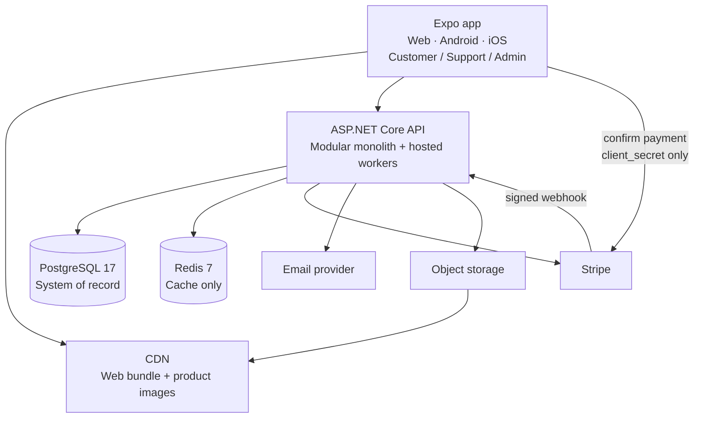
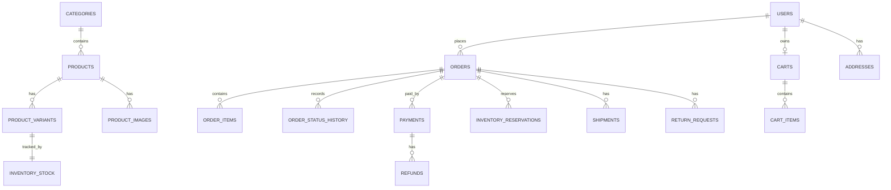
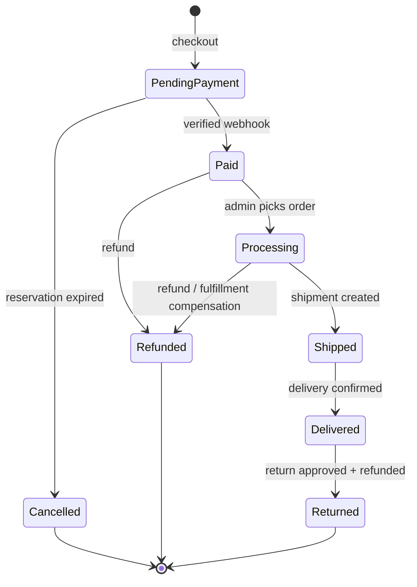
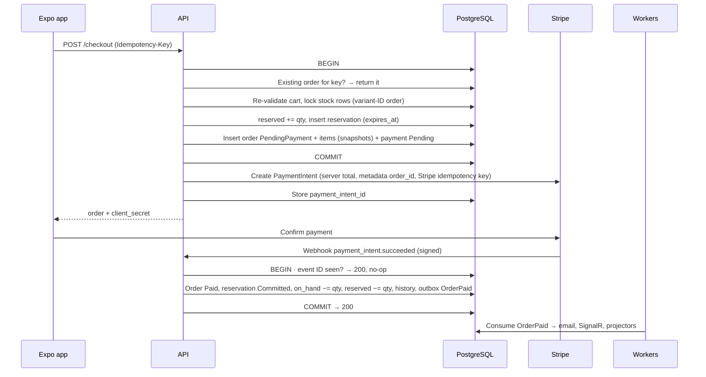
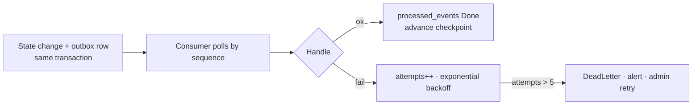
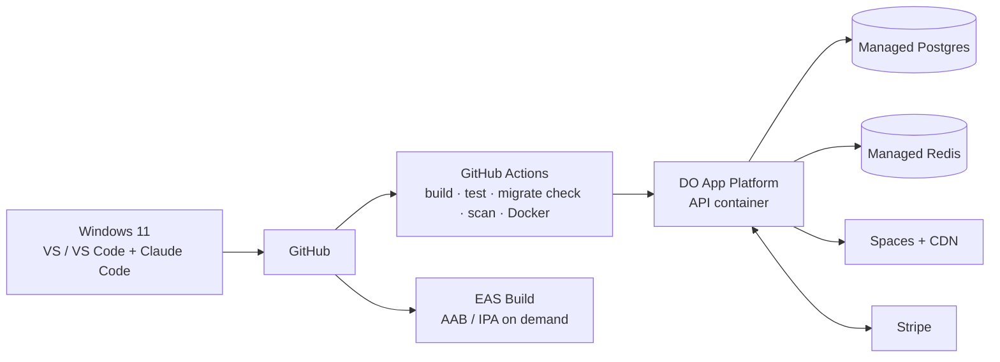

# Ecommerce Architecture

**Single source of truth for design, invariants, tests, and slice order.** Read before writing code. If a request conflicts with this file, the slice ends `BLOCKED` with the conflict in its report — never silently pick the easier path.

| Doc | Answers | Wins on |
|---|---|---|
| `docs/ecommerce-architecture.md` (this) | How is it built safely? | Invariants, boundaries, payments, data model, slice order |
| `docs/ecommerce-app-context.md` | What does it do, for whom? | v1 product scope, workflows, screens |
| `docs/quality-bar.md` | What must code prove to merge and ship? | Process gates |

Section numbers are referenced by agents and the quality bar. Do not renumber.

---

## 1. Context

**Builder:** Nathaniel — Sr. Software Developer (.NET/C#, React/TypeScript), Windows 11, no Mac, solo. Goal: staff engineer. This build is practice and an interview anchor: a familiar domain, so the conversation goes straight to the hard parts.

**Depth, not breadth.** The value is inventory races, idempotent payments, reservation expiry, outbox delivery, and failure handling — easy to fake in a demo, hard to get right in production.

**Done means:** a customer can browse, search, add to cart, check out, pay, get a confirmation, track fulfillment, and request a return — with no oversell, no double charge, and no lost order on crash or webhook retry. An admin can manage products, inventory, orders, and customers. Every hard invariant has a test written first.

**Not in scope:** marketplace, ML recommendations, microservices, store submission, go-to-market. Full list: app context §6.

---

## 2. Stack lock

Only Nathaniel changes the stack. Agents never do — a slice that would need a change ends `BLOCKED`.

| Layer | Choice | Notes |
|---|---|---|
| Backend | C# / ASP.NET Core, .NET 10 | Modular monolith: one API, one deployment |
| ORM | EF Core, code-first migrations | Npgsql provider |
| Database | PostgreSQL 17 | **System of record for all money, inventory, and order state** |
| Cache | Redis 7 | Cache, rate-limit counters, optional SignalR backplane. Never truth |
| Frontend | Expo + React Native + React Native Web, TypeScript, Expo Router, Metro | **One codebase** for web, Android, iOS. Store-ready, not submitted |
| Frontend state | TanStack Query (server state), Zustand (cart UI state only) | Cart is re-validated server-side at checkout |
| Auth | ASP.NET Core Identity + short-lived JWT + rotating refresh token | Roles: Customer, Support, Admin |
| Payments | Stripe PaymentIntents + signed webhooks | Test mode first |
| Email | `IEmailSender` (SMTP / Resend / SendGrid) | Provider chosen at deploy time |
| Images | S3-compatible storage (DO Spaces) + CDN | Never blobs in Postgres |
| Real-time | SignalR | Order status to the owning customer. Not required for correctness |
| Background work | `IHostedService` workers in the API process | Expiry, outbox consumers, projectors. No separate worker or broker in v1 |
| Observability | Serilog + OpenTelemetry | Correlation ID on every request, order ID on every order log |
| Tests | xUnit + Testcontainers (Postgres) + WebApplicationFactory | Integration tests on real Postgres, never in-memory EF |
| Frontend tests | Jest via `jest-expo` preset + React Native Testing Library (`@testing-library/react-native` + `test-renderer`) + `expo-router/testing-library` | Owner-approved amendment (Nathaniel, 2026-11-03). Expo's official runner; versions pinned to the SDK via `npx expo install`. Replaces nothing — the frontend had no runner. No Detox/Playwright/MSW in v1 (§11.3) |
| Hosting | DigitalOcean App Platform + Managed Postgres + Managed Redis + Spaces | Docker image from CI |
| CI | GitHub Actions | Build, test, migration check, secret scan, Docker build. No deploy on red |

**Frontend delivery:** web via `expo export --platform web` → CDN. Android and iOS via **cloud EAS Build** → signed AAB / IPA. No Android Studio, local Android SDK, Xcode, or Mac. No committed `android/` or `ios/` folders. No Kotlin, Java, Swift, Capacitor, or separate React DOM app. Local testing: Expo Go on a physical phone + web export.

**Open decisions — left blank on purpose. Never invent these; use config placeholders.**
Stripe keys and webhook secret · production domain · email provider and sender · Spaces bucket / CDN domain.

---

## 3. Architecture principles

### 3.1 Modular monolith

One API, one database, one deployment, **hard module boundaries inside**. Each module is a vertical slice that owns its entities, services, tables, endpoints, and events. This buys most of the isolation of microservices without distributed transactions.

1. A module reads another module only through its **public contract** (interface or domain event).
2. A module owns its tables. No other module writes to them.
3. Cross-module side effects go through the **outbox** (§8.4).
4. Extraction test: a module must be movable as its two projects (`Ecommerce.<Module>` + `Ecommerce.<Module>.Contracts`, §6.2) + its tables + its contract. If it can't be, the boundary is broken.

### 3.2 SOLID, concretely

| | In this codebase |
|---|---|
| **S** | `InventoryReservationService` reserves and releases stock — nothing else. `OrderService` orchestrates; it does not own gateway code. |
| **O** | Pricing, shipping, and payments are strategies: `IPricingRule`, `IShippingRateProvider`, `IPaymentGateway`. New carrier = new class, not a new `if`. |
| **L** | Any `IPaymentGateway` (Stripe, test fake, future gateway) is substitutable without changing checkout. A fake that behaves differently from Stripe is a leaking abstraction. |
| **I** | Small interfaces: `IInventoryReader`, `IInventoryReserver`, `IOrderReader`. No god `IRepository<T>`. |
| **D** | Application depends on `IPaymentGateway`, `IEmailSender`, `IClock`, `IIdempotencyStore`. A module's `Infrastructure/` folder (or `Ecommerce.Persistence` for platform tables, the host for `IClock`) implements them. Domain depends only on `Ecommerce.SharedKernel` (§6.2). |

### 3.3 Production-ready means

- **Correct under concurrency before fast.** Oversell and double charge are bugs; slow search is tuning.
- **Idempotent wherever money or state moves.** Same request twice = one effect.
- **Observable.** Which order, user, step, and external call failed — answerable in under 5 minutes from logs + correlation ID.
- **Recoverable.** Crash, webhook retry, provider outage → the system converges by retry, expiry, or outbox, with no manual DB edits.
- **Secure by default.** §10.1.

### 3.4 Hard rules

The canonical list. Breaking any rule blocks a merge (quality bar §1). Rules 1–6 can never be waived for a release.

1. **Server owns money.** Prices, discounts, shipping, tax, and totals are calculated server-side. Write DTOs are explicit — no client-settable `grand_total`, `status`, or price.
2. **Idempotency.** One idempotency key → at most one order. One Stripe event ID → at most one transition and one outbox event.
3. **No oversell.** Lock inventory rows in ascending variant-ID order, reserve in one transaction, commit only on Paid. Available = on_hand − reserved, enforced by a DB check constraint.
4. **Postgres is truth.** Redis is cache only. Checkout never reads stock from cache. Losing Redis loses nothing.
5. **Webhook is truth for payment.** Signature verified, unsigned requests rejected. Frontend success is a hint.
6. **Side effects via outbox**, inserted in the same transaction as the state change. No external call (Stripe, email, SignalR) inside a database transaction.
7. **Thin controllers.** Validate, call an application service, map the response. No business logic.
8. **Module boundaries.** No cross-module `DbSet` and no cross-module SQL join in application code.
9. **No `DateTime.UtcNow`** in domain or application code. Inject `IClock`.
10. **No secrets** in git, code, logs, or chat. No card numbers, passwords, full JWTs, or Stripe secrets in logs. Secrets live in env vars / secret manager.
11. **Authorization per endpoint and per resource.** A customer reads only their own orders and cart. Hiding UI is not authorization.
12. **Tests ship with the slice.** Every public method that moves money or stock is tested in the same slice. Hard invariants are test-first.
13. **Audit.** Stock adjusts, status overrides, and refunds write `audit_log` with actor, before, after, and reason.
14. **Legal transitions only** (§7.3), enforced in the domain and tested.
15. **Consistency boundary** (§8.8). Checkout, payment, and inventory never read from an eventually consistent read model. No message broker in v1.
16. **No unplanned dependency.** A NuGet/npm package is added only if Rob's plan names it, its reason, and what it replaces. A new database or external service is a stack change (§2).
17. **Frontend is Expo one-codebase** (§2). Platform-specific code lives only in `lib/platform.ts`.
18. **Migrations are backward-compatible** (§10.5). Rollback = redeploy the previous image against the current schema.

---

## 4. System diagram



- Clients never touch Postgres, Stripe secret keys, or object storage credentials.
- The signed webhook is the only path by which the outside world changes payment state.
- Workers (expiry, outbox consumers, projectors) run in the API process in v1.

---

## 5. Frontend architecture

### 5.1 Structure

```
frontend/apps/store/
  app/            # Expo Router screens (app context §5)
  features/       # catalog, cart, checkout, orders, admin — hooks + components
  components/     # shared RN components (rendered to DOM on web via RN Web)
  lib/
    api-client.ts # typed fetch client: auth, correlation ID — all platforms
    query-keys.ts # TanStack Query keys — single source for invalidation
    platform.ts   # ONLY per-platform code: payments SDK, push, secure storage, deep links
```

### 5.2 Rules

- **Estimate, never authority.** The UI shows an estimated total; the API returns the authoritative one.
- **Checkout idempotency.** One UUID per checkout attempt, sent as `Idempotency-Key`. Retries (double-click, network) reuse it.
- **Optimistic UI only where safe.** Cart add: yes. Checkout submit, payment confirm, return request: no — wait for the server.
- **Server result wins.** If price or stock moved, show what changed; never silently keep the old value.
- **Tokens.** SecureStore on native, secure storage on web — behind `platform.ts`.
- **SEO tradeoff accepted.** RN Web is client-rendered. If SEO becomes the measured bottleneck, add a Next.js storefront on the same API.
- **v1 budgets (targets):** no full reload on filter change, lazy images with explicit dimensions, at most one large hero image per page.

### 5.3 Routes

Defined in app context §5. Admin routes are hidden in the UI **and** blocked by role in the API.

### 5.4 Naming conventions

One rule underneath all of these: **a file is named after its single primary export when it has one (component → `PascalCase.tsx`, hook → `useThing.ts`); every other file and every folder is `kebab-case`.**

| Thing | Convention | Example |
|---|---|---|
| Route files in `app/` | Router-mandated. Lowercase `kebab-case` segments, `index.tsx`, `[param].tsx`, `_layout.tsx`, `+not-found.tsx`, `(group)/`. Never rename against the router: the file name **is** the URL | `app/reset-password.tsx`, `app/orders/[id].tsx` |
| Route component | `export default function` (required by Expo Router), named `<Area?><Entity>ListScreen` for `index.tsx` lists, `<Area?><Entity>DetailScreen` for `[param].tsx`, otherwise `<Area?><Name>Screen`. Layouts are `<Segment>Layout` | `OrderDetailScreen`, `AdminProductListScreen`, `CheckoutScreen`, `RootLayout` |
| `app/` contents | Routes and layouts only. No components, hooks, helpers, or tests in `app/` — the router turns every file there into a route | — |
| Feature folders | `features/<feature>/`, `kebab-case`, matching §5.1 and the backend module names. Inside: `components/`, `hooks/`, `api.ts`, `types.ts`, `store.ts` (Zustand, cart only) | `features/checkout/hooks/useCheckout.ts` |
| Components | `PascalCase.tsx`, file name = component name, **named export** | `components/PriceText.tsx` → `export function PriceText` |
| Props type | `<Component>Props`, a `type` declared beside the component; exported only if another file needs it | `type PriceTextProps = { … }` |
| Hooks | `useThing.ts` (camelCase, file = hook name), named export. TanStack Query hooks say what they do: `use<Entity>Query`, `use<Action>Mutation` | `useOrderQuery`, `usePlaceOrderMutation` |
| Lib / util modules | `kebab-case.ts`, named exports | `lib/api-client.ts`, `lib/query-keys.ts` |
| Platform splits | Metro extensions on the same base name, only under `lib/` (§5.2) | `lib/platform.native.ts`, `lib/platform.web.ts` |
| Types | `PascalCase`, no `I` prefix, no `T` prefix. Prefer `type`. API payloads are named after the API resource, with `Request` for bodies sent | `OrderSummary`, `CheckoutRequest` |
| Enumerations | No TS `enum`. A string-literal union whose values equal the API wire values exactly | `type OrderStatus = 'PendingPayment' \| 'Paid' \| …` |
| Constants | Module-level primitive constants `SCREAMING_SNAKE_CASE`; objects and functions `camelCase` | `MAX_CART_LINES`, `queryKeys`, `styles` |
| Variables / functions | `camelCase`. Booleans `is/has/can…`; handler props `on…`, handler functions `handle…` | `isPaid`, `onSubmit`, `handleSubmit` |
| Imports | Absolute alias `@/` (tsconfig `paths`, natively supported by Expo/Metro) instead of `../../..`. No barrel `index.ts` files — import the file directly | `import { ScreenStub } from '@/components/ScreenStub'` |
| Tests | Co-located `<file>.test.ts(x)`, same base name as the file under test — never under `app/`. Tests whose subject is a route live in top-level `tests/`: the route-table smoke test is `tests/routes.test.tsx`; a route-specific test mirrors the route path under `tests/app/` (§11.3) | `lib/query-keys.test.ts`, `tests/app/checkout.test.tsx` |
| Styles | `const styles = StyleSheet.create({…})` at the bottom of the file; keys `camelCase` | — |
| `app.json` | `name` = display name; `slug` and `scheme` lowercase `kebab-case`. `ios.bundleIdentifier` and `android.package` stay **unset** until the production domain is chosen (§2 open decisions), then reverse-DNS of that domain (`android.package` lowercase, no hyphens). Never invented | `"slug": "ecommerce-store"` |

---

## 6. Backend modules

### 6.1 Modules

| Module | Owns | Public contract | Must never |
|---|---|---|---|
| Identity | Users, roles, refresh tokens | `IUserReader`, `ICurrentUser` | Store order or payment data |
| Catalog | Products, variants, categories, image metadata, search data | `IProductReader`, `ProductPublished` | Change stock |
| Inventory | Stock, reservations | `IInventoryReader`, `IInventoryReserver` (reserve / release / commit) | Charge a card or create an order |
| Cart | User carts, guest merge, validation snapshot | `ICartReader` | Calculate final tax or shipping |
| Orders | Order aggregate, totals, status machine, shipments, returns | `IOrderReader`, `OrderPlaced`, `OrderPaid`, `OrderShipped` | Call Stripe directly |
| Payments | PaymentIntents, webhooks, refunds | `IPaymentGateway`, `PaymentSucceeded`, `PaymentFailed` | Change inventory or order items |
| Notifications | Email templates, email + SignalR consumers | Consumes events only | Write order state |
| Admin | Read models, dashboard projector, audit log | Reads via other modules' contracts | Bypass contracts to edit tables |

Each module is **two projects** (owner decision, Nathaniel, 2026-11-03 — "Module + Contracts", §13.2): `Ecommerce.<Module>` (implementation, `internal` by default) and `Ecommerce.<Module>.Contracts` (the "Public contract" column above: reader/reserver interfaces, integration events, DTOs). A contract that no other module consumes yet is added in the slice that first needs it; until then the Contracts project may be empty.

### 6.2 Repository layout and layers

```
backend/
  src/
    Ecommerce.Api/                    # host only: Program.cs, middleware, observability, health endpoints,
                                      # SystemClock, DI + module composition, module controller discovery,
                                      # design-time DbContext factory (dotnet-ef startup project)
    Ecommerce.SharedKernel/           # cross-cutting abstractions, no EF/ASP.NET/Npgsql: IClock, DomainException,
                                      # later Result/errors, shared Money, outbox/unit-of-work abstractions
    Ecommerce.Persistence/            # the one EcommerceDbContext, IModuleDbModel, DatabaseOptions,
                                      # Postgres readiness check, the single migration stream (Migrations/);
                                      # later the outbox/idempotency/audit platform tables (§7.1)
    Modules/
      Catalog/
        Ecommerce.Catalog/            # CatalogModule.cs (the only public type) +
                                      #   Domain/ Application/ Infrastructure/ (EF configs, read store, dev seed) Api/ (controllers)
        Ecommerce.Catalog.Contracts/  # public: IProductReader, ProductPublished, … (when first consumed)
      Inventory/
        Ecommerce.Inventory/          # InventoryModule.cs + Infrastructure/ (UnknownInventoryReader until Slice 2)
        Ecommerce.Inventory.Contracts/ # public: IInventoryReader, StockStatus (later IInventoryReserver)
      <Module>/ …                     # Identity, Cart, Orders, Payments, Notifications, Admin — same shape when their slice lands
  tests/
    Ecommerce.<Module>.Tests/         # per-module unit tests: Domain/ and Application/ (fakes), InternalsVisibleTo
    Ecommerce.ArchitectureTests/      # reference, visibility, layer, clock, and model-ownership rules (below)
    Ecommerce.Api.IntegrationTests/   # WebApplicationFactory + Testcontainers Postgres, real HTTP
frontend/
  apps/store/                         # Expo app (§5)
docs/
```

**Project reference rules** (compiler- and test-enforced; a violation fails `dotnet test`):

| Project | May reference (projects) | Packages / frameworks |
|---|---|---|
| `Ecommerce.SharedKernel` | nothing | none |
| `Ecommerce.<M>.Contracts` | `Ecommerce.SharedKernel` only | none |
| `Ecommerce.Persistence` | `Ecommerce.SharedKernel` | EF Core, Npgsql, health checks |
| `Ecommerce.<M>` | `SharedKernel`, `Persistence`, its own `Contracts`, other modules' `*.Contracts` — **never another module's implementation project, never `Ecommerce.Api`** | as its slice plan names; `Microsoft.AspNetCore.App` framework reference for controllers |
| `Ecommerce.Api` (host) | everything in `src/`; it must reference every module | Serilog, EF Core Design (design-time only, `PrivateAssets=all`) |

**Inside a module** the layers are namespaces/folders, `Ecommerce.<M>.Domain` / `.Application` / `.Infrastructure` / `.Api`. Dependencies point one way: **Api → Application → Domain**; Infrastructure implements Application interfaces; Domain depends only on `SharedKernel` and itself (not even its own or another module's Contracts); Application may also use Contracts (its own and other modules'); Api (controllers) never uses Infrastructure or EF. Only `<M>Module.cs` at the module root wires them together. A `using` that points the wrong way means the slice is wrong.

**Visibility.** Every implementation type is `internal`. The only public type in `Ecommerce.<M>` is the static `<M>Module` class: `Add<M>Module(IServiceCollection, IConfiguration)` plus any host-facing extras (Catalog: `DevSeedEnabledKey`, `AddCatalogDevSeed()`). `InternalsVisibleTo` is granted only to `Ecommerce.<M>.Tests` and, where HTTP fixtures need domain factories, `Ecommerce.Api.IntegrationTests` — never to another module. Controllers are internal; the host's `ModuleComposition.AddModuleControllers()` adds each module assembly (`ModuleComposition.ModuleAssemblies`) as an application part and registers `ModuleControllerFeatureProvider`, which discovers their internal `[ApiController]` types.

**Persistence.** One `EcommerceDbContext` (in `Ecommerce.Persistence`), one migration stream, one `__EFMigrationsHistory`, `public` schema, table names unchanged. Each module contributes its EF configuration through an internal `IModuleDbModel` registered by `Add<M>Module`; the context applies every registered model. Entity types are `internal` to their module, so no module can name — let alone `Set<T>()` — another module's entity (rule 8 by the compiler). Checkout (§8.2) gets Inventory + Orders + Payments + outbox in one transaction because every module in a request scope shares the same scoped context and connection; the transaction abstraction (`SharedKernel`, implemented in `Persistence`) is planned in Slice 2/4. Migrations: `dotnet-ef … --project backend/src/Ecommerce.Persistence --startup-project backend/src/Ecommerce.Api`.

**Architecture tests** (`Ecommerce.ArchitectureTests`, reflection + csproj/source scan, no extra package): project-reference table above (csproj `ProjectReference` and compiled assembly references); SharedKernel/Contracts free of EF, ASP.NET Core, Npgsql, Serilog, Stripe, Redis; the only exported type of a module implementation is `<M>Module`; `InternalsVisibleTo` only to allowed test assemblies; per-module layer rules (type signatures + source scan, no `global using` in modules); controllers live only in `Ecommerce.<M>.Api`; each `IModuleDbModel` configures only its own module's entities, all in `.Domain`; the host composes every module; no system-clock reads outside `Ecommerce.Api` (rule 9). Each rule evaluator has a self-test that proves it fails on a violating input.

---

## 7. Data model

Money is `numeric(19,4)` with a currency on every amount — never `float`/`double`. Timestamps are `timestamptz` UTC. Migrations are the source of truth; this is the v1 shape.



### 7.1 Tables

| Table | Columns and constraints |
|---|---|
| users | Identity tables + `display_name`, `created_at`. `email` unique (citext) |
| addresses | id, user_id, label, full_name, line1, line2, city, region, postal_code, country, is_default |
| categories | id, slug (unique), name, parent_id (nullable, one level in v1) |
| products | id, slug (unique), name, description, category_id, is_active (default false), created_at, updated_at |
| product_variants | id, product_id, sku (unique), name, size, colour, price, currency, compare_at_price, weight_grams, is_active |
| product_images | id, product_id, storage_key, alt_text, sort_order |
| inventory_stock | product_variant_id (PK), quantity_on_hand, quantity_reserved, `xmin` concurrency token. **CHECK (on_hand − reserved ≥ 0 AND reserved ≥ 0)** |
| inventory_reservations | id, order_id, product_variant_id, quantity, status, expires_at, created_at. Unique partial (order_id, variant_id) WHERE status = 'Active' |
| carts | id, user_id (unique — one cart per user), updated_at |
| cart_items | id, cart_id, product_variant_id, quantity, added_at. Unique (cart_id, variant_id) |
| orders | id, order_number (unique, e.g. `ORD-2026-000123`), user_id, status, subtotal, discount_total, shipping_total, tax_total, grand_total, currency, shipping_method, shipping_address_snapshot (jsonb), billing_address_snapshot (jsonb), idempotency_key (unique), stripe_payment_intent_id (unique, nullable), version, created_at, updated_at |
| order_items | id, order_id, product_variant_id, sku_snapshot, name_snapshot, unit_price_snapshot, quantity, line_total |
| order_status_history | id, order_id, from_status, to_status, changed_by, reason, created_at |
| payments | id, order_id, provider, provider_payment_id (unique), amount, currency, status, created_at |
| refunds | id, payment_id, provider_refund_id (unique), amount, reason, actor_id, created_at |
| shipments | id, order_id, carrier, tracking_number, shipped_at, delivered_at |
| return_requests | id, order_id, items (jsonb: variant, quantity), reason, status, admin_note, created_at, decided_at |
| idempotency_keys | key, scope (`checkout` / `stripe-event`), PK (scope, key), user_id, request_hash, result_ref, created_at, expires_at |
| outbox_events | sequence (bigint identity, PK), event_id (uuid, unique), event_type, aggregate_type, aggregate_id, aggregate_version, payload (jsonb), occurred_at. **Append-only**, retained for replay |
| consumer_checkpoints | consumer (PK), last_sequence, updated_at |
| processed_events | consumer, event_id, PK (consumer, event_id), status (`Done` / `DeadLetter`), attempts, next_attempt_at, last_error, processed_at |
| audit_log | id, actor_id, action, entity_type, entity_id, before_json, after_json, reason, created_at |

### 7.2 Day-one indexes

- `products(category_id, is_active)`; generated `tsvector` on name + description with a GIN index.
- `product_variants(product_id)`.
- `orders(user_id, created_at DESC)`, `orders(status, created_at DESC)`.
- `inventory_reservations(expires_at) WHERE status = 'Active'` — expiry job.
- `processed_events(next_attempt_at) WHERE status <> 'Done'` — retry scan.
- `order_items(order_id)`, `cart_items(cart_id)`. Unique constraints above already index their columns.

### 7.3 State machines — the only legal transitions



- **Order:** as above. A failed card does not cancel — the order stays `PendingPayment` and can be retried until the reservation expires. `Cancelled` is terminal; the customer checks out again (new key, new order). An admin **override** may force only a transition on this diagram, with a reason, and is audited. No transition rewrites totals or deletes history.
- **Payment:** `Pending → Succeeded | Failed`; `Succeeded → PartiallyRefunded | Refunded`; `PartiallyRefunded → Refunded`. `Succeeded` is set only by a verified webhook. A retry creates a new payment record on the same order.
- **Reservation:** `Active → Committed | Released | Expired`. All three are terminal — an expired reservation never commits.
- **Return request:** `Requested → Approved | Declined`; `Approved → Refunded`. Approval moves no money; the refund does, and it is audited.

Every transition is rejected in the domain unless it is listed here. A hidden button is not a control.

---

## 8. Workflows

If code contradicts this section, this section wins until it and its tests are explicitly updated.

### 8.1 Browse, search, cart

- Search, filter, sort, and pagination are server-side. Never "load all and filter on the client."
- Sorts in v1: relevance (full-text rank), price asc/desc, newest.
- The stock indicator (available = on_hand − reserved) may be cached for 10s. Checkout always re-reads Postgres under lock.
- `POST /cart/items` validates: variant exists and is active, 0 < qty ≤ per-order cap (config). Otherwise 400, no change.
- Guest cart lives on the device. On login, `POST /cart/merge` applies the merge rule (app context §4.4) and returns a merge result.

### 8.2 Checkout — the core workflow

The build is judged on this. It must survive double-click, network retry, refresh after payment, duplicate webhook, late webhook, and a crash between any two steps.

**Invariants**

1. One idempotency key → at most one order.
2. One PaymentIntent → at most one order.
3. Committed quantity never exceeds on-hand quantity.
4. Client totals are ignored; the server recalculates everything.
5. Unpaid reservations expire after a TTL (config, default **15 min**).
6. No end state may be "paid without an order" or "order without a payment record."



**Rules**

1. **Idempotency first.** An existing order for the key is returned as-is. If it has no PaymentIntent yet (crash after commit), create one now.
2. **One short transaction.** Lock `inventory_stock` rows with `SELECT … FOR UPDATE` in ascending variant-ID order (prevents deadlocks). On any failure, roll back everything and return which item failed and why.
3. **Reserve, don't decrement.** `on_hand` changes only on Paid.
4. **Stripe after commit, never inside the transaction.** Every Stripe call carries a Stripe idempotency key derived from the order (e.g. `pi:{orderId}:{attempt}`). If creation fails, the order stays `PendingPayment`; `POST /orders/{id}/retry-payment` creates a new intent on the same order.
5. **The client sees only `client_secret`.** The secret key never leaves the server.
6. **Webhook is truth.** Verify the signature; dedupe the event ID in `idempotency_keys`; apply the transition, inventory commit, and outbox insert in **one** transaction. A duplicate returns 200 (a 500 makes Stripe retry forever).
7. **Expiry.** The expiry worker releases the reservation, moves the order to `Cancelled`, and emits `PaymentIntentCancelRequested` (outbox → Stripe cancel).
8. **Late success.** If `payment_intent.succeeded` arrives for a `Cancelled` order, never resurrect it: record the payment, issue an idempotent automatic refund, audit it, and alert. This closes invariant 6.
9. **Side effects only via the outbox** (§8.4).

### 8.3 Inventory race

Ten concurrent checkouts for the last unit: each locks the row; the first commits its reservation; the other nine see available < qty, roll back, and get a per-item out-of-stock error. The UI shows the item that sold out and offers to remove it and retry. Abandoned reservations expire with no manual fix. Proven by test 1 (§11.2).

### 8.4 Outbox



- The outbox is an append-only event log. Each consumer (email, SignalR, Stripe-cancel, dashboard, search) tracks its own checkpoint and dedupes on `(consumer, event_id)`.
- Why not send inline? Email after commit can fail silently (paid order, no confirmation, no record). Email before a rollback confirms an order that doesn't exist. The outbox removes both.
- **External effects are at-least-once.** Make them idempotent at the receiver: provider idempotency keys where supported (Stripe), otherwise a `(consumer, event_id)` check before sending. A crash between send and mark can still cause one duplicate send when the provider has no idempotency key — this is documented, tested (test 15), and must be harmless.
- Dead letters never change order state. Count > 0 is an alert, not a log line.

### 8.5 Cancellation and refund

- Refunds go through `IPaymentGateway` with an idempotency key per refund; webhook-confirmed; the order goes to `Refunded` (or `Returned` for a return) with an audit entry.
- A refund never deletes an order or rewrites totals. It adds a refund record and a status change.
- **No auto-restock in v1.** Restock is a separate, audited admin stock adjust with a reason.

### 8.6 Fulfillment

Manual in v1: `Paid → Processing` (admin picks) → `Shipped` (carrier + tracking; `OrderShipped` → email) → `Delivered`. Automation can plug into the same transitions later. Compensation on unfulfillable orders: §8.8.4.

### 8.7 Admin catalog and inventory

- Products are created with `is_active = false`. Images go to object storage; only keys are stored.
- Initial stock is set via an audited adjust, then the product is published.
- An adjust that would make available < 0 is rejected **and audited**.
- Price changes never touch existing orders (snapshots).
- Production data changes happen only through audited endpoints — no direct SQL.

### 8.8 Eventual consistency (Slice 6b)

#### 8.8.1 The boundary

| Strongly consistent — one Postgres transaction | Eventually consistent — outbox → consumer |
|---|---|
| Checkout + reservation · Paid transition + inventory commit + outbox insert · refunds · stock adjusts · status changes | Dashboard KPIs · search read model · email · SignalR · customer analytics |

Nothing on the left may read from anything on the right. No RabbitMQ, Kafka, or other broker in v1 — the outbox table is the log.

#### 8.8.2 Projectors

- An event carries `event_id`, `aggregate_id`, and a per-aggregate monotonic `aggregate_version`.
- A projector updates its read model **and** inserts `processed_events` in one transaction — so a duplicate delivery is a no-op.
- **Out of order:** the read model stores the last applied version per aggregate. version ≤ stored → skip. version > stored + 1 → gap: retry with backoff, then dead-letter and alert. Never apply past a gap.
- **Sequence gaps:** identity values can commit out of order. Consumers read only up to rows older than a safety window (config, e.g. 2s), or rescan a trailing window; dedupe makes rescans safe.
- **Replay:** truncate the read model, reset the checkpoint to 0, and re-consume. Outbox rows are retained in v1 to make this possible.

#### 8.8.3 Lag and health

- Proposed v1 targets (confirm in the Slice 6b plan): dashboard and search ≤ 60s behind, email ≤ 2 min p95.
- The dashboard shows an **as-of** time. Each projector exposes last processed event, lag, and dead-letter count. Lag beyond target or any dead letter is an alert.
- Orders and payments are always correct even when a projector is stopped.

#### 8.8.4 Fulfillment compensation (saga)

The fulfillment process is a persisted saga keyed by order. If a fulfillment step fails finally (retries exhausted, or admin marks the order unfulfillable with a reason), compensation issues **exactly one** refund (idempotency key = saga ID + step), moves the order to `Refunded`, and audits it. A saga retry never creates a second shipment or a second refund. Rob challenges this design in plan mode before Slice 6b.

#### 8.8.5 Tests

Tests 11–18 in §11.2.

---

## 9. API surface (v1)

Base `/api/v1`. Errors are Problem Details (`application/problem+json`). Lists are paginated (`page`, `pageSize` ≤ 100) with a total count. Auth is Bearer, except public reads and the Stripe webhook (signature). Breaking changes go to `/api/v2`; v1 is never silently changed.

| Endpoint | Role | Notes |
|---|---|---|
| `POST /auth/register` · `login` · `refresh` · `logout` · `password-reset` · `password-reset/confirm` | Public / Customer | Refresh tokens rotate; reuse revokes the family |
| `GET /products?search=&category=&sort=&page=&pageSize=` | Public | Active products only |
| `GET /products/{slug}` | Public | Variants, images, stock indicator. Inactive → 404 (admin preview via admin API) |
| `GET /categories` | Public | |
| `GET /cart` · `POST /cart/items` · `DELETE /cart/items/{variantId}` | Customer | Server-validated prices |
| `POST /cart/merge` | Customer | Guest lines in; merge result out |
| `POST /checkout` | Customer | `Idempotency-Key` required. Returns order + `client_secret` |
| `POST /orders/{id}/retry-payment` | Owner | `PendingPayment` only. Same order, new intent |
| `GET /orders` · `GET /orders/{id}` | Owner | History, detail, timeline |
| `POST /orders/{id}/return-request` | Owner | `Delivered` only |
| `POST /webhooks/stripe` | Stripe | Signature verified, event-idempotent |
| `GET /admin/dashboard?period=` | Admin | Projected KPIs with as-of time |
| `GET/POST /admin/products` · `PUT /admin/products/{id}` · `POST /admin/products/{id}/images` · `POST /admin/products/{id}/publish` · `…/unpublish` | Admin | |
| `GET /admin/inventory` · `POST /admin/inventory/adjust` | Admin | Adjust requires a reason; audited |
| `GET /admin/orders` · `GET /admin/orders/{id}` | Admin, Support | |
| `POST /admin/orders/{id}/process` · `ship` · `deliver` · `refund` · `status-override` | Admin | Audited. Override requires a reason |
| `GET /admin/returns` · `POST /admin/returns/{id}/approve` · `decline` | Admin | Reason required |
| `GET /admin/customers` · `GET /admin/customers/{id}` | Admin, Support | Read-only. Support sees no revenue KPIs |

**Catalog read contract (Slice 1a):**
- **Visible** = `is_active` and ≥ 1 active variant; otherwise list-excluded and detail 404 (also 404 for a malformed slug).
- `page` ≥ 1 (default 1), `pageSize` 1–100 (default 20); out of range → 400, never clamped. Past the last page → 200, empty `items`, real `totalCount`. Response `{ items, page, pageSize, totalCount, totalPages }`.
- `sort` = `relevance | price-asc | price-desc | newest`; default `relevance` with `search`, else `newest`; `relevance` without `search` → 400. Every sort ends in a unique tie-breaker (`id`). Product price = minimum **active** variant price.
- `search` trimmed, ≤ 100 chars, `websearch_to_tsquery('english')` over the weighted generated `search_vector` (name A, description B).
- `category` = slug; matches the category and its direct children; unknown slug → 200 empty.
- `GET /categories` → `{ items: [{ slug, name, parentSlug }] }`, unpaginated (bounded one-level set — exception to the pagination rule).
- Slugs: `^[a-z0-9]+(?:-[a-z0-9]+)*$`, ≤ 100 chars, unique, not case-folded.
- Money on the wire: `{ "amount": "24.50", "currency": "USD" }` — amount is a decimal **string**; clients format only. `stockStatus` = `Unknown | InStock | Low | Out`.

---

## 10. Cross-cutting concerns

### 10.1 Security

- Passwords: Identity defaults; never stored plain or logged. Lockout on repeated failures.
- JWT access token 15 min. Refresh token rotated, stored hashed, revoked on logout and password change.
- Per-resource authorization: `GET /orders/{id}` requires owner, Admin, or Support. Another customer's order returns **403** (test 7).
- Validation (FluentValidation) on every write DTO. No mass assignment.
- Rate limits per IP + user on login, checkout, and webhook (the webhook must still accept Stripe retries). Generous limits on catalog reads.
- CORS: configured frontend origins only, never `*` with credentials.

### 10.2 Caching — performance layer, never truth

| Data | Cache | Invalidation |
|---|---|---|
| Product list / detail | Redis 60s, images on CDN | Delete keys on product/variant change |
| Categories | Redis 5 min | On change |
| Stock indicator (display) | Redis 10s | TTL only. Checkout re-reads Postgres under lock |
| Cart, totals, orders, payments | **Never cached** | — |

Redis down → cache-aside falls back to Postgres (slower, correct). Postgres down → no fallback, by design.

### 10.3 Observability

- Every error is Problem Details with `traceId`; no stack traces to clients.
- Correlation ID: taken from the request header or generated, and echoed in the response. Every order log carries `OrderId` + `CorrelationId`. Structured templates only (`Log.Information("Order {OrderId} paid", id)`).
- `/health/live` (process only) and `/health/ready` (Postgres reachable **and** no pending migrations → 200, else 503). Redis, once added (Slice 7), reports `Degraded` only — still 200 — because Redis is never truth (§10.2, rule 4). Traffic routes on Ready.
- Day-one metrics: checkout attempts and success rate, webhook failures, reservation expiries, dead letters, projector lag, p95 checkout latency.

### 10.4 Scaling — planning estimates, not promises

| Stage | Load | Change |
|---|---|---|
| Launch | ~100 orders/day, ~10k views/day | One API container, small managed Postgres, Postgres full-text |
| Growing | ~1k orders/day, ~100k views/day | API replicas (stateless), Redis on, CDN, fix slow queries with indexes before hardware |
| Scaling | ~10k orders/day, ~1M views/day | Workers in their own process (same code, new entry point), read replica for catalog reads, dedicated search only if measured |

**Add a service only when a metric proves the current layer is the bottleneck.** Checkout is write- and lock-heavy and will never scale like reads; keep transactions short and external calls outside them.

### 10.5 Deployment



- Migrations run as a separate, reviewed step before the new version takes traffic. Use expand/contract: add nullable → backfill → require in a later deploy. Never drop a column that the running version reads.
- Rollback = redeploy the previous image against the current schema. A migration that breaks this blocks the deploy.
- No manual production data edits — audited endpoints only.

---

## 11. Testing

### 11.1 Pyramid

- **Domain (fast, many):** state machines, money rounding, pricing order, expiry math with a fake clock.
- **Application (medium):** checkout orchestration and saga steps with fake gateway, email, and clock.
- **Integration (mandatory):** WebApplicationFactory + Testcontainers Postgres — real transactions, locks, constraints, and webhook signatures with a test secret.

### 11.2 Required tests for v1

| # | Scenario | Must prove |
|---|---|---|
| 1 | 10 parallel checkouts, 1 unit in stock | Exactly 1 reservation; 9 clean failures; available never < 0 |
| 2 | Same idempotency key twice | 1 order, 1 PaymentIntent |
| 3 | Same webhook event twice | 1 transition, 1 outbox event |
| 4 | Reservation passes TTL | Stock released, order `Cancelled`, new checkout succeeds |
| 5 | Client sends a lower total | Server total wins; intent amount = server total |
| 6 | Price changes after order | Order item snapshot unchanged |
| 7 | Customer A requests customer B's order | 403 on read, cancel, and refund |
| 8 | Paid, then API crashes before webhook processing | Webhook retry reconciles to `Paid`; no duplicate order |
| 9 | Email provider down | Order stays `Paid`; retry delivers; no duplicate email |
| 10 | Admin adjust below available 0 | Rejected; audit shows actor and attempt |
| 11 | `OrderPaid` twice → dashboard projector | Revenue counted once |
| 12 | `OrderPaid` twice → search projector | Index unchanged on second delivery |
| 13 | Dashboard projector down 10 min, restarted | Catches up from checkpoint; nothing lost or double-counted |
| 14 | Version 5 arrives before version 4 | No wrong status; holds or alerts on the gap |
| 15 | Crash after email send, before mark | At most one email, or the duplicate is proven harmless — state which |
| 16 | Fulfillment step fails finally | Exactly one refund; order `Refunded` with audit; no duplicate shipment or refund on retry |
| 17 | Search read model dropped and replayed | Results match pre-drop results on a fixed dataset |
| 18 | Dashboard projector stopped | Order still reaches `Paid` with correct detail; dashboard shows as-of time |
| 19 | Webhook succeeds for a `Cancelled` order | Order stays `Cancelled`; exactly one automatic refund; alert raised |

**Test-first:** 1, 2, 3, 4, 11, 13, 16, 19. If you can't write the test, you don't understand the invariant yet.

### 11.3 Frontend tests

Runner: Jest (`jest-expo` preset) + React Native Testing Library + `expo-router/testing-library` (§2). Tests run in Node against the RN component tree; they prove UI contracts, never money or stock — those are proven server-side by §11.2.

**What must be tested (every slice that touches the frontend):**

- **Pure logic** in `lib/` and `features/*/` (`api.ts`, `store.ts`, `types.ts` helpers, hooks): every exported function or hook has a co-located test.
- **Components with behavior** (props that change output, state, handlers, conditional rendering, navigation): a co-located test of the behavior and its accessible role/label. Purely static markup needs no test.
- **Routes:** every route in app context §5 renders under the real root layout at its URL (`tests/routes.test.tsx`). Screen-level behavior belongs in `features/` and is tested there; screens stay thin.
- **Network:** mock `fetch` with `jest.fn()` / `jest.spyOn(globalThis, 'fetch')`. No MSW or other mocking package in v1.
- **Platform splits:** when `lib/platform.native.ts` / `lib/platform.web.ts` land, the Jest config switches to per-platform projects (`jest-expo/ios`, `jest-expo/android`, `jest-expo/web`) in the same slice, so each split is tested on its platform.
- **Not in v1:** device E2E (Detox/Maestro) and browser E2E (Playwright). EAS release candidates are smoke-tested by hand on Expo Go and the web export.

| # | Slice | Scenario | Must prove |
|---|---|---|---|
| F1 | 0 (retro) | Route table | Every app context §5 route renders its screen at its URL under `RootLayout`; an unknown URL renders Not found |
| F2 | 1 | `lib/api-client.ts` | Sends the correlation ID and bearer token; maps ProblemDetails to a plain-language error with a retry action; never logs the token |
| F3 | 3 | Cart re-validation / merge | Server result wins: changed price or stock is shown to the user, the old value is never kept; merge result is shown, never dropped silently |
| F4 | 4 | Checkout idempotency key | One UUID per checkout attempt; double-submit and network retry reuse the same `Idempotency-Key`; a new attempt gets a new key |
| F5 | 4 | Checkout submit | No optimistic order: submit is disabled while pending; the success screen shows `PendingPayment` until the server reports `Paid` |
| F6 | 4 | Checkout request and total | The request body carries no price, total, or status field; the displayed total is the server's response value |
| F7 | 1 | Role-gated admin UI | Admin routes are hidden and redirect for a Customer (UI only — API test 7 is the real authorization) |
| F8 | 6 | Return request | No optimistic submit; server error shows a plain-language message with retry |

**Frontend test-first:** F4, F5, F6 (they are the client side of hard rules 1, 2, and 5).

**F2 split (Slice 1a/1b):** 1a proves the correlation ID, ProblemDetails → plain-language error mapping, and retry; 1b adds the bearer token and the "never logs the token" assertion, when tokens exist.

### 11.4 Enforcement in CI

- **Backend:** `dotnet test` fails when any test project discovers zero tests (`TreatNoTestsAsError` in `backend/tests/test.runsettings`). Coverage is collected (`Code Coverage`, cobertura) and uploaded as an artifact with TRX results — **no percentage gate** (quality bar §5).
- **Frontend:** `npm test -- --ci --coverage` (Jest fails on zero tests by default; `--passWithNoTests` is banned). Coverage is uploaded as an artifact — no percentage gate.
- **Hygiene step (frontend job):** fails on any test file under `app/` and on any focused test (`it.only`, `test.only`, `describe.only`, `fit`, `fdescribe`), because a focused test silently drops every other test.
- **Not gated:** lint and formatting (style never blocks, quality bar §3); skipped tests are a review check (quality bar §4.2).

---

## 12. Working with Claude Code

### 12.1 Ownership

| Owner | Work |
|---|---|
| Nathaniel | Owns the stack lock (§2) and scope. Reads each final report and Rob's review. Commits |
| Rob (architect agent) | Slice plans, plan-mode challenges, boundary and invariant reviews, keeps this file current |
| Marco (developer agent) | Implements one planned slice and fixes review findings |
| Nobody, without a test first | Checkout, reservation, webhook handling, refunds, projectors |

Session workflow, prompts, and deny rules: `CLAUDE.md`. Gates: `docs/quality-bar.md`.

### 12.2 Process rules

1. **Autonomous loop, no approvals** (`CLAUDE.md`): Rob plans → Marco builds → Rob reviews → fix (at most 3 rounds) → final report → agents AVAILABLE.
2. One slice per request, in §12.3 order. Every slice starts with a Rob plan; Orders, Inventory, Payments, and 6b get the full plan-mode challenge.
3. **No agent commits.** Changes stay in the working tree for Nathaniel.
4. A slice reports PASS only on a real PASS. Otherwise it reports `BLOCKED` with reasons.

### 12.3 Slice plan

| Slice | Scope | Done when |
|---|---|---|
| 0 Foundation | Solution + Expo scaffold (screens stubbed), DI, Postgres + migrations, health, Serilog + correlation ID, CI | `dotnet test` green; `/health/ready` 200 with Postgres up; web export builds |
| 1 Identity + Catalog | Auth, roles, products, variants, categories, list/detail/search (full-text), admin create. **Split into 1a → 1b** (below) | Public browse/search/paginate; admin creates a product (no stock) |
| 1a Catalog browse | Catalog module (products, variants, categories, image metadata), `GET /products`, `/products/{slug}`, `/categories`, Postgres full-text search, stock indicator via `IInventoryReader` stub (`Unknown`), Development-only idempotent seeder; Expo Home (search + categories), `/products`, `/products/[slug]` on TanStack Query | Public browse/search/filter/sort/paginate end to end; inactive invisible by direct link; F2 (correlation ID + ProblemDetails part) |
| 1b Identity + admin create | Auth (register/login/refresh rotation/logout/reset), roles, admin product create/edit/publish, admin preview, bearer in `api-client` | Admin creates a product (no stock); F2 (bearer part), F7 |
| 2 Inventory | Stock, reservation, release, expiry worker, check constraint, audited adjust | Tests 1, 10 |
| 3 Cart | User cart, guest merge, validation snapshot | Merge never drops silently; merge result shown |
| 4 Checkout + Payments | Idempotent checkout, Stripe intent, signed webhook, Paid + commit, outbox insert, late-success refund | Tests 2, 3, 4, 5, 6, 8, 19 |
| 5 Orders + Fulfillment | History, timeline, process/ship/deliver, tracking, status machine, overrides | Test 7; illegal transitions rejected in domain and API |
| 6 Notifications + Returns | Outbox consumers (email, SignalR), return requests, admin refunds | Test 9; no duplicate email on retry |
| 6b Eventual consistency | Dashboard + search projectors, checkpoints, gaps, replay, fulfillment saga | Tests 11–18 |
| 7 Hardening | Rate limits, caching (§10.2), slow-query pass, staging deploy | §14 green; staging end-to-end works |

**Do not skip to Slice 4.** Slices 0–3 make it testable.

**Slice 1 split (Rob, 2026-11-03, owner-requested):** 1a → 1b → 2; 1b must PASS before Slice 2. Browse is entirely public (§9), so it has no auth dependency; auth (rotation, reuse detection, lockout) deserves its own review. **Deferred within v1:** Home "best sellers" and detail "related products" (app context §4.1.1, §4.2.4) need Paid order data — scheduled by Rob in the Slice 5 plan. Plan: `slice-plans/slice-1a-plan.md`.

---

## 13. Tradeoffs

### 13.0 Constraints that drive every choice

1. **Staff path is .NET.** Depth in one stack beats breadth in three.
2. **Solo, Windows, no Mac.** Anything that needs three frontends, a Mac, or a team to operate fails on day one.
3. **Correctness under failure over feature count.** Each choice is judged first on whether it makes the invariants easier to prove.

If a constraint changes, re-argue the stack. The interview form: *"I chose X because of these constraints, gave up Y, and would switch to Z when this metric changes."*

### 13.1 Stack

| Choice | Why | Gave up | Rejected | Revisit when |
|---|---|---|---|---|
| **.NET 10 / ASP.NET Core** | Day-job and interview stack; strong typing; built-in DI, middleware, Identity | One language end to end; npm breadth; fewer copy-paste starters (more deliberate code) | Node (splits depth), Django, Rust, Spring (language friction over design) | Targeting a non-.NET staff role |
| **EF Core** | Migrations versioned with code; transactions fit checkout; Postgres locking and constraints supported | SQL visibility; N+1 risk — hence explicit `FOR UPDATE`, slow-query pass, real-Postgres tests | Dapper alone (hand-written everything, more ways to get transactions wrong) | A hot path needs hand-tuned SQL (use raw SQL there, keep EF elsewhere) |
| **PostgreSQL 17** | ACID across reservation, order, and outbox; row locks; check and unique constraints; full-text — no extra service | Horizontal write scale; dialect differs from SQL Server | MongoDB (weaker integrity for money and stock), SQL Server (valid, but managed Postgres is simpler and cheaper on DO) | Load exceeds primary + replicas, or a workload needs a dedicated engine beside it |
| **Redis 7, cache only** | Read-heavy catalog; rate-limit counters; future SignalR backplane | Simplicity; invalidation bugs; every read needs a Postgres fallback | Redis as lock or stock truth (a flush = oversell); in-memory cache (breaks with replicas) | — |
| **Expo one codebase** | Only credible way for one Windows developer to ship web + Android + iOS; stays in React; EAS removes the Mac | Web SEO vs Next.js; heavier web bundle; DOM-only libraries unavailable; SDK upgrades move together | Three native codebases (scope), Capacitor (thin wrapper, store-rejection risk), Flutter (new language), Next.js + native (two codebases) | SEO measured as the bottleneck → add a Next.js storefront on the same API |
| **TypeScript, Metro, Expo Router** | One typed API client for all platforms; file-based routing | Vite's faster web loop and plugins | — | — |
| **TanStack Query + Zustand** | Server state with caching and invalidation; tiny UI state without Redux | Redux devtools; needs query-key discipline | Redux (boilerplate), bare `useState` (collapses at scale) | — |
| **Identity + JWT + rotating refresh** | Tested hashing, lockout, and roles; short tokens limit leak damage | Session simplicity; revocation is not free; per-platform secure storage | Hand-rolled auth; hosted provider (less learning, extra vendor) | Need for SSO / social login at scale |
| **Stripe PaymentIntents + webhooks** | Keeps PCI scope small; mature test mode and CLI; event IDs make idempotency testable | Fees, lock-in, webhook latency (honest `PendingPayment` UI), reconciliation work | Own card handling (PCI), PayPal only, cash on delivery (skips the lesson) | Need another method → second `IPaymentGateway` |
| **`IEmailSender`, Spaces + CDN, SignalR** | Swappable provider; images out of Postgres; .NET-native real-time | Deliverability setup (SPF/DKIM) not automated; SignalR needs a backplane at scale | Images in Postgres, inline email, separate WebSocket service | — |
| **In-process workers** | One deploy, one log stream, same transaction rules | Independent scaling; shares the API process | Separate worker, broker | Background load measured as the bottleneck → same code, own process |
| **Serilog + OTel, Testcontainers** | Traceable in minutes; real-Postgres tests catch lock and constraint bugs | Slower tests, needs Docker | In-memory EF (hides exactly these bugs) | — |
| **Jest + `jest-expo` + RNTL** (owner-approved 2026-11-03) | Expo's official, SDK-pinned runner; mocks native modules; `expo-router/testing-library` renders real routes; same Babel transform as the app | Speed and native ESM of Vitest; a real device or browser | Vitest (no maintained RN/Expo preset), Detox/Maestro and Playwright E2E (device/browser infra a solo Windows dev can't run per PR) | A bug class appears that only a device or browser reproduces → add on-demand E2E against EAS / web export |
| **DigitalOcean + Docker + Actions** | Managed DB backups and failover; portable image; no deploy on red | AWS/Azure breadth | Azure (more cost and complexity at this scale), raw VPS (ops burden, backup risk) | A needed managed service is missing — Docker + standard Postgres keep the move cheap |

### 13.2 Architecture decisions

| Decision | Chose | Gave up | Why |
|---|---|---|---|
| Monolith vs microservices | Modular monolith | Independent deploys | Checkout + reservation + order in one transaction. Distributed transactions make the core invariant harder |
| Inventory lock | Postgres `FOR UPDATE` + check constraint | Some raw throughput | Truth stays in Postgres; Redis loss can't oversell |
| Reserve vs decrement at checkout | 15-min reservation, commit on Paid | Stock held briefly by abandoned checkouts | Keeps "paid but no stock" and "stock lost to abandoned carts" separate problems |
| Payment truth | Signed webhook | Slower UI confirmation | The client can be faked, refreshed, or closed |
| Search | Postgres full-text | Advanced ranking and facets | Not the bottleneck at launch |
| Read models | Outbox + in-process projectors | Broker features (fan-out, retention tooling) | Same transaction guarantees; no new infrastructure in v1 |
| Fulfillment | Manual admin transitions | Automation | State machine + audit are the lesson; automation plugs into the same transitions |
| Readiness vs Redis | Postgres + migrations gate Ready; Redis only degrades | Early warning that cache is down via readiness | A Redis outage must not pull traffic when cache-aside still serves correct data |
| Backend project layout (owner decision, Nathaniel, 2026-11-03) | **Module + Contracts**: per module `Ecommerce.<M>` (internal implementation with Domain/Application/Infrastructure/Api folders) + `Ecommerce.<M>.Contracts`; shared `Ecommerce.SharedKernel`, `Ecommerce.Persistence`; host `Ecommerce.Api`. Replaces the shared layer projects (`Ecommerce.Domain/Application/Infrastructure`) organized by module folder | Fewer projects; layer purity enforced by assembly references (Domain could not reference EF at all) — now layers are folders checked by architecture tests (signatures + source scan) | Module boundaries become compiler-enforced: a module cannot reference another module's implementation, and `internal` types make cross-module entity or service use impossible to compile. Still one deployable modular monolith; stack lock unchanged. **Revisit when** project count slows the build measurably, or a module needs its own process (§10.4) |
| DbContext layout (re-argued for Module + Contracts) | One `EcommerceDbContext` in `Ecommerce.Persistence`, one migration stream and history table, `public` schema; modules plug in internal `IModuleDbModel` configurations | Per-module DbContexts, schemas, and migration histories (fully independent persistence per module) | §8.2 needs inventory + order + payment + outbox in **one** transaction; one scoped context makes that the default instead of a cross-context shared-connection protocol. Moving tables to per-module schemas breaks rule 18 (the previous image reads `public.*`). Rule 8 is compiler-enforced by internal entity types. **Revisit when** a module is extracted (§3.1.4) |
| Migrations location | Migrations + snapshot in `Ecommerce.Persistence`; `IDesignTimeDbContextFactory` in the host (`Ecommerce.Api/Composition`) built from the same `AddEcommerceModules` composition as runtime; `Microsoft.EntityFrameworkCore.Design` referenced by the host with `PrivateAssets=all` (existing package, version already pinned — not new) | `Design` assemblies ship in the API image; a separate `Ecommerce.Migrations` project would avoid that | The design-time model must include every module, and only the host references every module. One composition function for runtime and design time means the drift check cannot miss a module. Migrations stay in the context's own assembly, so no `MigrationsAssembly` setting can silently find zero migrations |
| Module controllers | `internal` controllers in `Ecommerce.<M>.Api`, discovered by a host `ModuleControllerFeatureProvider` over the module assemblies | MVC's default public-only discovery | Public controllers would force their services, criteria, and result types public, leaking the module's implementation |
| Clock in the host | `SystemClock` lives in `Ecommerce.Api/Time` and is registered by the host; everything in `SharedKernel`, `Persistence`, and `Modules/` reads time only through `IClock` | — | Rule 9, widened: the architecture test scans all of them, so the only system-clock read is in the composition root |
| Frontend exports and imports | Named exports + `@/` alias everywhere except `app/` routes (default, router-mandated) | Shorter `import X from` lines; relative paths with zero config | Named exports keep one name across files (grep, rename, auto-import); the alias survives moving files between features. Both use built-in Expo/TypeScript support — no new package |
| Frontend test runner | Jest via `jest-expo` + RNTL + `expo-router/testing-library`, dev dependencies only (§2 amendment, owner-approved) | Zero-dependency frontend; Vitest speed | The frontend had no runner, so F4–F6 (client side of rules 1, 2, 5) could not be proven. Replaces nothing; never shipped in the bundle |
| Test enforcement | CI fails on zero discovered tests (backend `TreatNoTestsAsError`, Jest default) and on focused tests; coverage uploaded as an artifact with **no % gate** | A coverage number to point at | Quality bar §5: coverage proves nothing about oversell. A silently empty or focused suite is the real hole |
| Route test location | Top-level `tests/` (`tests/routes.test.tsx`, `tests/app/<route path>.test.tsx`) | Strict co-location for routes | Expo Router turns every file in `app/` into a route, so route tests can't sit beside their file |
| Lint / format in CI | Not gated (no ESLint, no `dotnet format --verify-no-changes`) | Automatic style consistency | Quality bar §3: style never blocks. `tsc --strict` and `dotnet build` are the static gates. Revisit at Slice 7 with the warnings-as-errors switch |
| Local Postgres 17 | Docker only (Testcontainers + Compose on 127.0.0.1:5434, trust auth) | Native-DB speed | Stack lock is PG17; CI and local use the same engine; no secret in local config |
| Stock indicator before Inventory exists (1a) | Catalog calls `IInventoryReader` (Inventory's contract) once per request; Slice 1a registers a stub returning `Unknown`, and the UI shows no badge for `Unknown`. Slice 2 swaps the registration; Slice 7 caches it 10s | A visible indicator in 1a | Rule 8 — no cross-module DbSet/join; never claim "In stock" without data; Inventory classifies (threshold), Catalog never sees quantities |
| Search source in 1a | Generated weighted `tsvector` + GIN on the `products` table (system of record) | Read-model decoupling until 6b | Strongly consistent and correct now; the 6b search projector replaces the source behind `ICatalogReadStore` with the same HTTP contract |
| Money on the wire | Decimal **string** + currency (`{ amount: "24.50", currency }`) | Arithmetic-friendly JSON numbers | Rule 1 — JS parses JSON numbers as binary floats; the client only formats |
| Dev data and images | Development-only, config-gated, idempotent seeder via domain + EF (startup fails if enabled outside Development); image URL = config `Catalog:Images:BaseUrl` + key, `null` while the placeholder is empty | Realistic images in local dev | "No direct SQL" and §2 open decisions — no invented bucket/CDN domain |
| CORS | `Cors:AllowedOrigins` config only (`http://localhost:8081` in Development; empty in committed prod config), no credentials in 1a | Zero-config cross-origin | §10.1 — configured origins only; production origin is an open decision |
| Expo SDK patch alignment (Rob, 1a review) | CI keeps `npx expo install --check` as a blocking gate; when Expo publishes new SDK patches, the next slice aligns them with `npx expo install --fix` and re-pins exact. That is not a new package (same package, SDK-recommended patch) | A hermetic CI: the check reads Expo's live recommended versions, so it can turn red with no code change | Native-module/SDK mismatch is invisible in Jest and web export but breaks EAS builds and Expo Go; a red gate is the cheap warning. Any slice whose diff fails it is blocked |
| Catalog list query shape (1a) | One EF statement: page subquery (`LIMIT/OFFSET`, unique tie-breaker) joined to `ROW_NUMBER() OVER (PARTITION BY product_id)` derived tables for cheapest active variant and first image; count is a separate statement (2 round-trips) | Per-page-only work: the window may scan all active variants/images before the join | Correct and N+1-free at launch scale. **Slice 7 slow-query item:** measure; if needed, a `LATERAL ... LIMIT 1` or a denormalized "from price" column. Count and page are separate snapshots (READ COMMITTED), so a publish between them can skew `totalCount` by one — acceptable for display |

---

## 14. Production readiness (release gate)

- [ ] Tests 1–19 (§11.2) pass on real Postgres; frontend tests F1–F8 (§11.3) pass.
- [ ] Stripe test mode end to end: checkout → webhook → Paid → email → shipped → delivered.
- [ ] Reservation expiry proven in staging with a short TTL.
- [ ] Dead-letter and projector-lag alerts wired (log + admin view at minimum).
- [ ] Secret scan clean on the release branch (`sk_live`, `sk_test`, `whsec_`, private keys).
- [ ] Migrations backward-compatible and applied to a staging DB that mirrors prod.
- [ ] Rate limits on login, checkout, and webhook; Stripe retries still accepted.
- [ ] Audit log covers stock adjusts, refunds, and overrides.
- [ ] Rollback tested: previous image runs against the current schema.
- [ ] README covers local run (Postgres via Docker, `stripe listen`) and tests.

---

## 15. Next steps

1. Nathaniel reads this file — especially §7.3, §8.2, §8.8, and §13 — and edits anything he disagrees with.
2. Fill the §2 open decisions in local config or a secret manager only, never in docs.
3. Ask for Slice 0. The loop in `CLAUDE.md` runs it end to end and returns a final report.
4. Build Slices 1–4 slowly. If Slice 4 feels easy, an invariant is missing — go back to §8.2.

*Updated 2026-11-03 · .NET 10 + Postgres modular monolith · Module + Contracts backend projects (§6.2, owner decision) · Expo one-codebase frontend · §8.8 eventual consistency · §11.3–11.4 frontend tests and CI test enforcement (owner-approved §2 amendment).*
